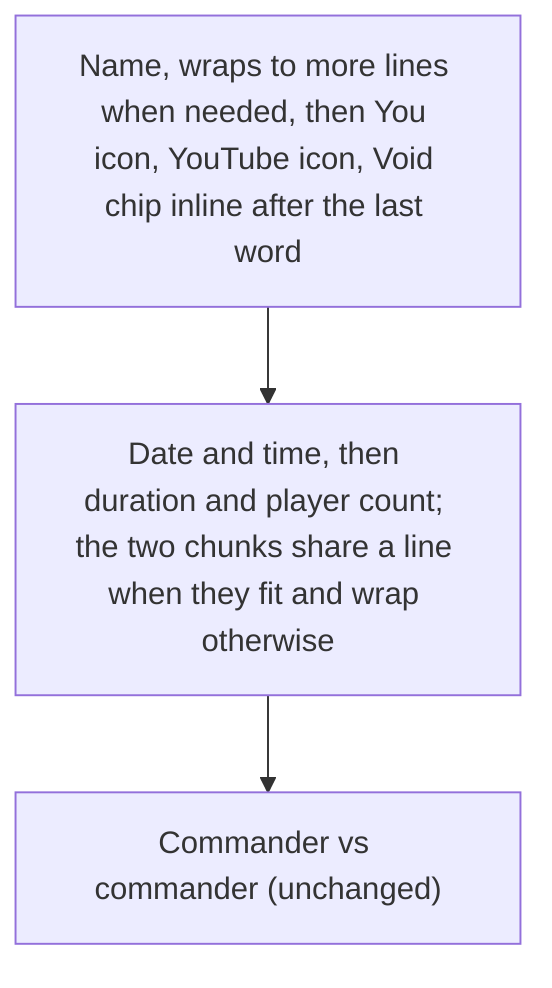

# Meta, home, Game Watch, and match-gallery UI pass

Four pages. Each is independent, so they can land in any order. Everything here is HTML / CSS / browser JS: no pipeline run, no `PIPELINE_VERSION` or `match.schema_version` bump, and nothing feeds a rating.

## 1. Meta page (`/meta/`)

Files: [meta/index.html](meta/index.html), [js/meta.js](js/meta.js), [js/all-matches-aggregator.js](js/all-matches-aggregator.js), [js/charts.js](js/charts.js), [css/vtstats-theme.css](css/vtstats-theme.css).

### Pills

Today the page is one long scroll. Put it behind three Bootstrap pills, using the ELO page's pattern (`nav nav-pills` inside `.vt-tab-scroll-wrap`, `?tab=` written with `history.replaceState`).

- **Faction** (default). Writes no `?tab=`. `?tab=faction` or an unknown value opens it and drops the param.
- **Playtime** (`?tab=playtime`). Match Duration, Player Count, Start hour, Day of week, Month, Matches Over Time, in today's layout.
- **F9 stats** (`?tab=f9`). The existing F9bomber card. If `f9_community.json` is missing, the pane shows a one-line empty state, not a blank tab.

Playtime charts draw on the first `shown.bs.tab`, or at boot when the URL opens that pill. A canvas inside a hidden pane measures zero, so `renderAll()` must not draw them up front. The Faction win-rate chart is on the default pill and still draws at boot. The `data-expand` fullscreen handlers stay as they are.

### Faction pill layout

One row. Left: Faction win rate by map. Right: Faction Matchups above Faction Win Rate.

```html
<div class="row g-4">
  <div class="col-lg-6 vt-meta-maps-col"><!-- map card --></div>
  <div class="col-lg-6">
    <div class="d-flex flex-column gap-4">
      <!-- matchups card, then win-rate card -->
    </div>
  </div>
</div>
```

The existing `.vt-meta-maps-col` / `#section-meta-maps` rule (absolute stretch, scrolling table, sticky header) already sizes the map card to the right column, so the map table becomes as tall as both right-hand cards with no new CSS. Update that rule's comment, which still says the matchup card alone sets the height.

### Duration bars

`durationBand()` in the aggregator and `renderMetaDurationHistogram()` in `js/charts.js` are the only code that reads `duration_bands`. Keep the three short bands and replace `15plus` with five. Upper edges are exclusive, so a 15:00 match lands in 15–20m.

- Labels: `<5m`, `5–10m`, `10–15m`, `15–20m`, `20–30m`, `30–45m`, `45–60m`, `60m+`
- Keys: `under5`, `5to10`, `10to15`, `15to20`, `20to30`, `30to45`, `45to60`, `60plus`

The Players hub and ELO page call the same aggregator but never read this block. The match picker's duration filter is separate and stays as it is.

## 2. Home page, Online now card (`index.html`)

Files: [index.html](index.html), [css/landing.css](css/landing.css).

`#vt-home-live-host` sits inside `#vt-home-live-empty`, which `paintLive()` in [js/landing.js](js/landing.js) hides whenever a lobby is showing, so Host disappears as soon as anyone is online. Move that anchor into the card header, immediately left of the Game Watch link, and leave the empty block with just "No lobbies up right now." Same Steam link, `btn btn-primary btn-sm`. No JS change.

```html
<div class="vt-home-card-head">
  <h2 id="vt-home-live-title"><i class="bi bi-broadcast-pin"></i>Online now</h2>
  <div class="vt-home-live-actions">
    <a id="vt-home-live-host" class="btn btn-primary btn-sm" href="steam://rungame/624970/76561198955218468/-hostname%20%22bz2vsr%22%20-nomovies" title="Host a lobby via Steam">Host</a>
    <a href="gw/">Game Watch</a>
  </div>
</div>
```

`.vt-home-card-head a` restyles every header link as small primary text. Scope it to `a:not(.btn)` so Host stays a solid button, and give `.vt-home-live-actions` an inline flex row with a small gap.

## 3. Game Watch (`/gw/`)

Files: [gw/index.html](gw/index.html) (and [css/gw.css](css/gw.css) only if spacing needs it).

Add the same Host anchor (same href, `btn btn-primary btn-sm`) in `.vt-gw-header-lead`, right after the Game Watch `h1` and before the lobby-count chips. That row is already an inline flex with a gap, so it sits beside the title. The `?embed=1` mode keeps the header strip, so the button shows there too.

## 4. Match gallery cards (`/matches/`)

Files: [js/app.js](js/app.js) (`buildMatchPickerCardHtml`, `stampPickerYouMark`, `stampPickerVodMark`), [css/vtstats-theme.css](css/vtstats-theme.css) (the `.vt-match-picker-card-*` block and `.vt-match-picker-you`).

The text side of a card is only about 160px wide (300px card, 96px thumbnail). The name shares its row with the duration / player count and a "You commanded" pill, and is clipped with an ellipsis. The same cards appear in the in-match picker modal, so this fixes both. The home page's Latest matches card keeps its text pills.

New card text, top to bottom:



- **Name.** Remove the nowrap / ellipsis on `.vt-match-picker-card-name` (`white-space: normal`, `overflow-wrap: anywhere` for a single long word). The title stops being a flex row so the marks flow inline after the text. The selected card's check mark is absolutely placed at the top right, so the title gets right padding when the card `is-active`.
- **Dropped.** The `.bzn` file line and the submitter line. Both stay searchable: the search blob is built from manifest data, not card text. The submitter filter in the sidebar still works. Delete the now-unused `-rawmap`, `-submeta`, `-submitter` CSS. `submitterCreditText()` stays because the match-info banner uses it.
- **Facts row.** `fmtDateFull(entry.date)` and `33m 47s · 10p`, muted Geist Mono, as two nowrap chunks in a wrapping flex row.
- **You mark.** One small icon in place of the text pill: `bi-shield-fill` with tooltip "You commanded this match", `bi-person-fill` with tooltip "You played this match". It uses the same rule as today: commanded first, otherwise played. It is primary-tinted, about the YouTube icon's size, and has an `aria-label`. `stampPickerYouMark()` swaps the icon class and tooltip text when the Who setting changes, and removes the icon when it no longer applies.
- **YouTube mark.** Same icon. The plain `title` becomes the same Bootstrap tooltip ("YouTube VOD").
- **Tooltips.** Marks carry `data-bs-toggle="tooltip"` and `data-bs-title` (no native `title`, which would show twice). Create the tooltip on first hover from one delegated listener on the grid, so roughly 300 cards do not each build one at boot. Dispose of an icon's tooltip before replacing or removing that icon.

## Docs

- [docs/DATA_DICTIONARY.md](docs/DATA_DICTIONARY.md): `duration_bands` example gets the eight keys.
- [.cursor/rules/filter-contract.mdc](.cursor/rules/filter-contract.mdc): the `meta_charts` row names the new band keys.
- [.cursor/rules/project-overview.mdc](.cursor/rules/project-overview.mdc): one clause noting `/meta/` has Faction / Playtime / F9 stats pills (`?tab=`).

## Checks (browser)

- `/meta/`: on Faction, the map table fills the left column beside the stacked matchup and win-rate cards. Playtime shows eight duration bars and the when-played charts at full size. F9 stats shows the ledger card. `?tab=playtime` and `?tab=f9` open the right pill. A theme switch still recolors a chart drawn after its pill opened.
- Home: Host sits left of Game Watch in the Online now header both with a lobby up and with none.
- `/gw/`: the primary Host button sits beside the Game Watch title.
- `/matches/` with a Who player set: long names (for example "Island of ~Vertigo~") show in full, the shield and person icons show tooltips on hover, YouTube and Void marks still show, and the selected card's check mark does not cover the name. Check one narrow phone width too (the card folds to thumbnail-on-top below 480px).
