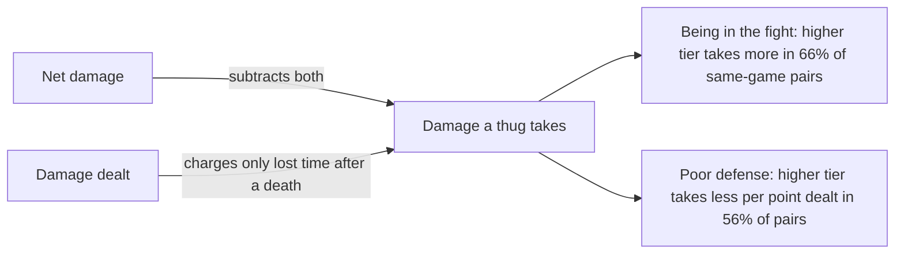

# VTSR-T: damage dealt vs net damage as a measure of thug skill

## Scope and method

The question here is narrow: which number better measures one thug's effectiveness for VTSR-T, and do the resulting tiers reflect real thug skill? Scrap and the economy are out of scope.

- **Data:** 288 rated matches and 1,909 thug rows. Commanders are excluded from every comparison.
- **Method:** the published rating (enemy damage dealt) and the memo's net candidate (`enemy_dealt - enemy_received`, shared out against the lobby the same way) were both replayed in memory with `scripts/vtsr_t_variants.py`'s own functions. Nothing was written to disk.
- **How the measures are judged:** there is no ground truth for "thug skill", so each measure is tested on what a skill rating has to do:
  1. Stay stable for the same player.
  2. Let a pre-match rating predict the next game.
  3. Put the stronger thug in the higher tier when two thugs share a game.
  4. Measure the player rather than the team result.
  5. Resist posing.

## Bottom line

- **Damage dealt stays.**
  - On the skill tests the two are tied or damage dealt is slightly ahead.
  - Net damage is more tied to the team result.
  - It moves ratings more per game.
  - It compresses the top of the ladder.
- **Doma has one real point, and it is a better point than "use net".** How much damage a thug takes is a stable personal trait that VTSR-T ignores entirely. But most of it measures being in the fight, not bad play, and net damage subtracts both.
- **Sev's "already accounted for" is only partly true.** A death costs you only the damage you didn't get to deal. Taking damage costs you nothing directly.

---

## Section 1: The skill tests

- **Both measure the same core thing.**
  - Per-game scores correlate 0.92.
  - Final ratings correlate 0.90 for players with 25+ rated matches.
- **Consistency (split-half reliability, odd vs even games):**
  - Damage dealt 0.955, net 0.929.
  - Net moves a rating more per game: 19.6 points on average against 17.9.
- **A pre-match rating predicting the next game.** Pooled correlation between the rating before the game and the score in it:
  - Damage-dealt rating: 0.425 against the damage-dealt score, 0.294 against the net score.
  - Net rating: 0.417 and 0.314.
  - Ranking players within the same game gives the same picture (0.398 / 0.270 against 0.405 / 0.300).
  - Each predicts its own score slightly better. This is a tie.
- **Tier ordering.** In the same game, how often did the higher-tier thug outscore the lower-tier one?
  - Damage-dealt tiers: 71.6% overall, 65.4% one tier apart, 80.7% two or more tiers apart.
  - Net tiers: 70.9%, 66.2%, 82.1%.
  - Scored on the net score instead: 64.0% against 64.8%.
  - Another tie.
- **Team-result dependence.** How much of a thug's score is explained by win or loss:
  - Damage dealt 23%, net 27%.
  - Net is the less individual measure, because losing thugs get shot more.
- **Picking winners.**
  - The team that dealt more damage won 91.3% of the time; the team ahead on net, 91.0%.
  - Forward check since the switch (57 decided games): AUC 0.610 for damage dealt, 0.597 for net, 0.613 for the old four-axis rating. That does not trigger the memo's revert rule.
- **Tier placement for the 24 players with 25+ rated matches:**
  - 12 keep the same band and 16 the same tier. 8 move one tier, none move two.
  - Net would drop high-volume fighters:
    - VTrider: Tier 0 Lower to Tier 1 Lower.
    - Domakus: Tier 1 Upper to Tier 2 Upper.
    - Vivify: Tier 2 Lower to Tier 3 Upper.
    - Cyber: Tier 2 Upper to Tier 3 Upper.
    - HappyOtter: Tier 3 Lower to Tier 4 Upper.
  - Net would lift cautious, PvE-heavy low-tier players:
    - judgeguns and DraconisMarch: Tier 4 Upper to Tier 3 Lower.
    - dd: Tier 3 Upper to Tier 2 Lower.
  - Net squeezes the ladder toward the middle.

**Verdict:** net damage is not a better skill measure on any test. Damage dealt is more consistent and less team-driven, and the two produce equally accurate tiers.

---

## Section 2: Damage taken, Doma's real point

- **It is a real, stable trait.**
  - The damage-taken score (damage taken against the room's total) is as stable as damage dealt: reliability 0.956.
  - It is nearly independent of damage dealt: correlation 0.13.
  - The team result barely explains it: 4%.
  - So VTSR-T ignores a persistent personal signal. "Damage dealt already captures it" is not accurate.
- **What damage dealt does capture.**
  - Deaths cut damage share in 76% of matches (correlation -0.35).
  - Time on foot correlates -0.52 with damage share.
  - Damage you take is credited to the enemy who dealt it. That raises the room total and lowers everyone's share a little, but it is not charged to you directly.
- **It is mostly exposure, not bad play.**
  - The higher-tier thug took more damage in raw terms in 66% of same-game pairs (71% at two or more tiers apart).
  - Per point of damage dealt, the higher tier took less only 56% of the time (61% at two or more tiers apart).
  - So there is a modest defensive-skill component, and the tiers already partly reflect it. The larger part is simply being where the fighting is.
  - Net subtracts both parts, which is why it drops the most active fighters.
- **At team level:**
  - The team that took less damage won 69% of the time.
  - The team that took less damage per point dealt won 86%.
  - The team that dealt more damage won 91%.
- **Posing, both ways:**
  - **Damage dealt** pays for trading ships for damage.
    - The literal case is Hadean's Xerrakis kamikaze: 4 games, 106 seconds in total, about 45k damage.
    - Doma's archetype (80%+ PvE damage and top-10% deaths) is 11 rows in the whole corpus. 5 gained, and 4 of those 5 would also gain under net.
    - Gaining rating while taking more damage than you dealt happened in 10 of 1,200 gains, all in games of 3 to 18 minutes, median +3.9.
  - **Net** pays for avoiding contact.
    - The_Bylarge, `2026-04-22T01-41-45`: took 1.4k damage. +20 under damage dealt, +58 under net.
    - The Wanderer and Monkey lost their games but gain under net.
    - Damage from enemy turrets also counts against the thug assaulting a base.
- **Doma's scenario, in hit points only.** Lose 10 Xypos (1,800 HP each) and kill 10 scavengers (3,000 HP each): about 30k dealt and 18k taken. Net is +12k, so net would not punish it. Damage dealt already does: a median thug deals about 78k per hour, and the lowest thug in Doma's linked 80-minute game ([2026-10-24T01-51-11](https://vtstats.bz/matches/?match=2026-10-24T01-51-11)) dealt 92.5k and lost 14.1 points.

**Verdict:** Doma is right that VTSR-T is blind to how much damage a thug takes, and that this is a stable trait. He is wrong that net damage is the fix: it mixes exposure in with poor defense and penalizes engagement. The only defensible candidate is a trade-quality term (damage taken per point dealt), and it would need a rule written before it is tested. On these numbers I would expect a small gain at most, since it orders same-game tiers correctly only 56-61% of the time.

---

## Section 3: Corrections to both sides

**Sev**
- **"Already mathematically accounted for":** only partly. Deaths count through lost time; taking damage counts only by raising the room total.
- **"Losing rating points during all of that dying":** VTSR-T updates once per match, and a death has no direct price.
- **"People who die a lot are rated way less":** weak. Career deaths per minute correlates -0.26 with rating, against 0.89 for damage per minute.
- **"Damage dealt is the best measure":** it ties net on the skill tests. It was chosen by the memo's simplest-that-passes rule plus reliability ([critique/decisions/vtsr-t-enemy-damage.md](critique/decisions/vtsr-t-enemy-damage.md)). In the original decision run, net had slightly better winner numbers.

**Doma**
- **Net is not more accurate on any skill test,** and it is more team-dependent.
- **His example comes out net-positive.**
- **"Trash early, make up for it later"** applies equally to net, since both are whole-match totals.
- **"Removing net":** net damage was one of the four axes in the old rating until 2026-10-24. The single axis replaced the composite because it was simpler, more consistent and predicted no worse, not because net failed.

---

## Section 4: Do the tiers reflect true thug skill?

**For**
- Reliability is 0.955.
- Within a game, the higher tier outscores the lower 72% of the time, rising to 81% at two or more tiers apart.
- A pre-match rating ranks the next game with correlation of about 0.40.

**Limits**
- **Adjacent tiers overlap heavily:** one tier apart is only 65/35.
- **Win or loss explains 23%** of a thug's score.
- **Defense is ignored,** though its skill component is modest.
- **Faction leaks into thug scores.**
  - The analysis page's claim that both teams' faction effects cancel in the lobby is wrong per player. One faction's thugs score above the room, like a winning team's.
  - Raw average match score: ISDF thugs +0.145, Hadean +0.022, Scion -0.016.
  - Under 30 minutes: ISDF +0.18 against Scion -0.05. At 30+ minutes it flips: Scion +0.12, ISDF +0.02.
  - These are raw figures, not adjusted for who was on each team.
  - Regulars rotate factions, so across 15 regulars the effect of their faction mix spans only +0.035 to +0.069 in average match score.
- **The analysis page's earlier limits still apply:** the commander adjustment is set to the average commander, and time spent shipless costs rating.

**Verdict:** the tiers are a fair, coarse sort of thug damage output in context. A gap of two or more tiers is reliable; a one-tier gap is not. They do not measure complete thug skill. The main missing piece is trade quality, not net damage. Faction adds noise to single games but little bias over a career.

---

## Section 5: Faction and role, only where they touch VTSR-T

- **Faction**
  - The Phase 6 Hadean term belongs to VTSR-C, not VTSR-T. It is now HOLD at 74 confirmation duels: the frozen +60 makes confirmation log-loss and accuracy worse, and refitting on those duels gives +7 points.
  - Scion scales with game length: 35% wins under 30 minutes (expected 49%), 79% at 30+ (expected 59%), 14-0 against ISDF at 30+ minutes.
  - For VTSR-T this is noise in single games (Section 4), not a reason for a faction term.
  - **Verdict:** no faction term in VTSR-T. Correct the analysis page's "cancels" wording.
- **Role and the late game**
  - Damage is a weaker read on long games. The team that dealt more damage won 95% of games under 30 minutes, 77% at 30-60 minutes and 64% at 60+ minutes. Net does no better (94%, 81%, 68%).
  - Long games have fewer deaths per minute (0.193 down to 0.128).
  - "Roles become more defined late" was not testable with whole-game totals.
  - Games of 30+ minutes are 17% of rated matches, and each counts once.
  - **Verdict:** partly supported. Nothing should change without a pre-registered long-game study.

---

## Follow-up work (only on approval)

- **Forward check:** run the official harness and append the result to the memo's Results section (57 games, no revert).
- **Faction confirmation:** append the first 60+ confirmation result (HOLD) to [critique/decisions/phase-6-faction-advantage-term.md](critique/decisions/phase-6-faction-advantage-term.md), as that memo requires.
- **Analysis page** ([elo/analysis/index.html](elo/analysis/index.html)):
  - Add a damage dealt vs net damage FAQ entry and subsection with Sections 1 to 4.
  - Fix the leftover four-axis wording.
  - Correct the faction "cancels" claim.
  - Add the Phase 6 HOLD and the long-game note.
- **Optional:** pre-register a trade-quality candidate before testing it.
- **Optional studies:** faction damage-share trend split by winning and losing side; an early-versus-late role study from the raw events.
- **Discord reply:** a short, neutral reply for Doma.
