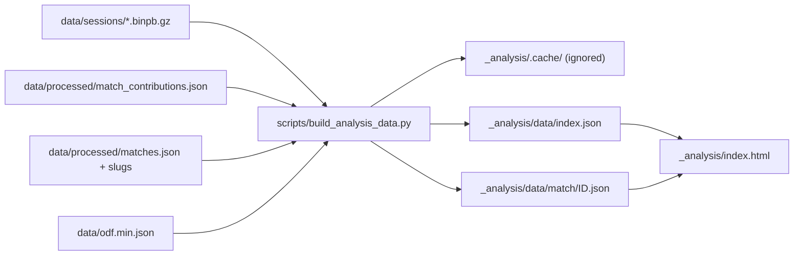

# Playstyle Analysis (`/_analysis/`)

## Shape

- **Location.** The tool gets a new root folder, `_analysis/`, which is committed and served at `vtstats.bz/_analysis/`. It doesn't exist yet and isn't ignored, and `.nojekyll` lets GitHub Pages serve underscore folders. The only [.gitignore](.gitignore) change is one line, `/_analysis/.cache/`, for the build cache. It is unrelated to the existing `_map-analysis/`.
- **Discoverability.** No nav link, no canonical or OG tags, and `<meta name="robots" content="noindex,nofollow">`. The page is called **Playstyle Analysis** (`<title>Playstyle Analysis — VT Stats</title>` and the page heading). Copy stays playful and neutral, with nothing about cheating.
- **Self-contained folder.**
  - The page: `_analysis/index.html`, `_analysis/js/analysis.js`, `_analysis/css/analysis.css`, `_analysis/data/`.
  - Shared site CSS and JS load from the root (`../vendor/...`, `../css/...`), the same depth as [meta/index.html](meta/index.html).
  - Promoting it to prod later is a folder move plus one nav link.
- **Rating-inert.** The tool is not part of `process_stats.py` and not in the pipeline cache key. `scripts/elo*.py`, `process_stats.py` and `js/all-matches-aggregator.js` must never read its output.

## 1. Build script: `scripts/build_analysis_data.py`

The script is standalone, run after `process_stats.py`, like `validate_elo.py`.

- **Inputs.** Raw sessions are read with `process_stats.load_session()`. Identity follows the pipeline: apply `ACCOUNT_REROUTES` / `_apply_account_reroutes_to_events` (lines 715 and 5034 of [scripts/process_stats.py](scripts/process_stats.py)) so the shared-account case matches the dashboard. Names come from `player_slugs.json` and the per-match leaderboard. The raw file is located through `match.submitter` and `match.source_file`.
- **Coverage.** Every player with at least 10 matches. Campod and low-activity rows are kept but flagged.
- **Per-match cache.** Stored in `_analysis/.cache/`, keyed by match id, raw file size and mtime, and `SCRIPT_VERSION`. Flags: `--jobs N`, `--force`, `--only <id>`. A cold run takes roughly 10–15 minutes (390 files, 1.5 GB); reruns take seconds.
- **Deterministic output.** The permutation-test and jitter RNGs are seeded per (match, player, streak) so committed JSON does not churn between runs.

### ODF reload model

Every timing metric is measured against what the ODF says the weapon allows, never against a hardcoded list. The model is built once from [data/odf.min.json](data/odf.min.json), following `inheritanceChain`, and keyed by (ship ODF, weapon ODF).

- **Which weapon fired.** Ordnance maps to weapon through `ordName`. When several weapons share an ordnance, the one the current ship can mount wins: it must match a hardpoint category (`HP_` prefix of `weaponHardN`) and the assault flag. This is the same matching rule as `js/weapons-calc.js` `resolveVariant`. The ship comes from `PlayerState.odf` at the shot's tick.
- **Groups.** A group is the hardpoints with the same type and assault flag, unless `weaponGroupN` overrides it. Only a shot from a different group counts as a partner, because weapons in one group fire together without a switch.
- **Effective reload in ticks**, at 20 ticks per second:
  - `ceil(shotDelay × 20)` when all hardpoints fire together (`shotAlternate 0`). Same-tick shots merge into one volley.
  - `shotDelay / hardpoints` when barrels alternate (`shotAlternate 1`).
  - Salvo weapons (`salvoCount` / `salvoDelay`) count one salvo as one volley, timed from its first round.
  - `InitialShotDelay` is added after a switch-back (a fresh press). Only the gas mortars `ggasmortvsr` / `ggasmortfvsr` (25 s reload + 1.5 s) and `fball2b` carry it today.
- **Excluded from reload timing, with the reason recorded.**
  - Charge guns (`shotDelayN`; the 5 MAG / `eglase` ODFs): the gap depends on hold time.
  - Lock-on weapons (23 ODFs with `lockDelay`, plus TargetingGunClass tag-then-salvo): lock time dominates.
  - Dispensers and mines: they emit no `BulletInit`.
  - Cycles where the ammo before the shot (`PlayerState.ammo`) was below the shot's `ammoCost`. That gap is ammo starvation, not timing.
- **Calibration.** The script records the observed corpus floor per (ship, weapon): the smallest volley gap across every player.
  - Where the floor is below the ODF reload (for example two mortar sources on one player), the pair is flagged in the weapon reference table and left out of the on-the-dot counts until it's explained.
  - The probe already confirms the ODF floor holds for the Blast Cannon: `shotDelay 2.0` gives a 40-tick minimum for every player checked.

### Raw-recording metrics

Metrics are computed per player-match, plus a breakdown per ship (so a Xares or Walker filter works) and per weapon pair. Each one reuses the investigation's definitions, generalized to any reload length.

- **Weapon switching.** A switch is two consecutive firing ticks, at most 20 ticks apart, whose group sets are disjoint. Groups come from the reload model above. Reported:
  - switches per active firing minute;
  - the share of switches at 1, 2, 3 and 4+ ticks;
  - the median switch gap.
- **Reload timing on switch-backs.** This covers every pair of groups whose reloads differ, from Dragon Blast's 0.3 s to Hellfire's 6 s and the gas mortar's 25 s.
  - A **switch-back** is two consecutive anchor volleys, at most `reload + max(20 ticks, reload)` apart, with at least one partner-group shot between them. The anchor is the slower-reloading group.
  - **Margin** = gap minus effective reload: how late the shot was after the weapon became ready, in 50 ms steps.
  - **Dead time** = time from the last partner shot to the anchor shot, minus the partner's own reload: partner fire lost to switching early or to a missed first click.
  - **Held cycles** (no partner shot between) are counted separately. The engine refires at exactly 0 margin while the trigger is held, so they say nothing about switch timing. The probe found 372 of Certified Bad Guy's ~400 held MDM Mortar cycles at 0 margin.
  - **Quadrants:**
    - on the dot and seamless (margin and dead time both 1 tick or less);
    - early and waited;
    - late but seamless;
    - late and lost fire.
  - **Per player-match-anchor output:** the switch-back count, median and spread of margin and dead time, the quadrant shares, and a compact 2-D histogram (margin 0–20+ ticks × dead time 0–10+ ticks) for the density map.
  - **Probe baseline**, from five matches with partnered Blast Cannon or MDM Mortar cycles:
    - Median margin 150–350 ms.
    - On the dot in 13–42% of switch-backs.
    - On the dot and seamless in only 5–25%.
- **Alternation rhythm.**
  - The anchor and partner come from the reload model. A cycle is a switch-back as defined above, so the gap limit scales with the weapon's reload instead of the old fixed 12 ticks. A streak is at least 10 cycles.
  - Per streak: a linear-fit period and residual spread, the permutation p-value (1,000 shuffles, only when a streak has at least 3 minority and 3 mode gaps), the metronome-model implied jitter (grid of 2–30 ms), and the longest clock-perfect run inside the streak (consecutive cycles whose spread stays at most 1.1 ticks).
  - Per match: cycles, median period, the share of testable streaks with p < 0.01 ("even share"), the clock-perfect cycle share (shown with an integer-period caveat), and the median jitter.
- **Silent ammo drops.**
  - Residual = ammo change from tick t to t+1, minus the ammo cost of shots fired at t (lag 1).
  - A drop counts when its size matches a weapon mounted on the current ship that fires without a `BulletInit` (mines and dispensers).
  - Each drop is classed as in-cycle, breaking a cycle, or isolated, and reported per 1,000 cycles.
- **Sanity checks.**
  - Same-tick multi-group fire share.
  - Reload violations: volley gaps shorter than the effective reload from the model. This should be 0 outside flagged pairs.

### Joined from `match_contributions.json`

The script adds these metrics from the processed data (it does not recompute them):

- shots fired;
- overall accuracy (`shots_hit/shots_fired`), with an era flag for matches before and after 2026-10-18;
- PvP hit share (`pvp_shots_hit/shots_fired`);
- T-key (`target_lock_pct`, gated on `has_target_lock_data`);
- PvP K/D, damage per minute and PvP damage per minute;
- per-weapon hits from `weapon_breakdown` and per-ship values from `per_ship_combat`;
- ship time shares from `loadout.ships`;
- role, format, and the campod and low-activity flags.

### Output

- **`data/index.json`.** Schema 1, containing:
  - a metric catalog (id, unit, group, direction, minimum sample for career boards, and which era caveat applies). Labels, explanations and leader titles are page copy in `analysis.js`, not data;
  - the event markers (the 2026-10-18 recorder change);
  - the players (Steam64, name, slug, match count);
  - compact per player-match rows (per-ship and per-pair sub-blocks);
  - a compact **streak table**, one row per alternation streak (match, player, pair, ship, start tick, cycles, period in ms, spread, p, jitter, longest clock-perfect run, gap string such as `7666676667...`). It powers the leader boards, the rhythm map and the drill-down list without extra fetches.
  - the **reload-timing blocks**, per player-match-anchor (stats + 2-D histogram), plus a per-weapon population summary (percentiles of on-the-dot and seamless shares across all players) so the page can say "top 3% of Blast Cannon users";
  - the **weapon reference table**, per (ship, weapon): ODF `shotDelay`, hardpoints, `shotAlternate`, salvo, `InitialShotDelay`, effective reload, observed floor, exclusion reason, mismatch flag, and shot count.
- **`data/match/<id>.json`.** Loaded on demand for the drill-down. It holds delta-encoded lanes (anchor shots, partner shots, silent drops) covering the alternation windows only.
- **Size budget.** Under about 10 MB total. The build fails loudly if it goes over.

## 2. Page: `_analysis/index.html`

### Shell and shared controls

- **Shell.**
  - Head and script order mirror [meta/index.html](meta/index.html).
  - Topnav copied from the canonical snippet in `models/index.html`.
  - Vendored `vendor/chartjs/chart.umd.min.js`, `chartjs-plugin-zoom.umd.min.js` and `hammer.min.js`.
  - Dates use a linear x axis with ms timestamps, the same pattern as `js/player.js`. No date adapter is needed.
  - Series colours are read from `--kb-*` variables, and charts are rebuilt on theme change.
  - Tabs render lazily on first show.
- **Tabs.** `Leaders` (default) · `History` · `Compare` · `Reload timing` · `Rhythm map` · `All players`, routed with `?tab=`.
- **Shared filter bar.** All state lives in the URL (`players`, `metric`, `x`, `smooth`, `ship`, `pair`, `from`, `to`, `split`, `win`, `per`) and is written with `replaceState`, so a link reproduces the view for reviewers.
  - Player multi-select with search, up to 6 players.
  - Ship and weapon-pair selects, a date range, and a split date.
  - The tab-specific controls are listed under each tab.

### Leaders tab

The tab is a grid of cards, each a top-5 board. Every row shows the player, the value with its timing in ms, the match date, the ship and the weapon pair. Clicking a row opens the drill-down, and a link opens the match dashboard.

- **Card header.** Each card is headed by a fun title, the same style as the per-match highlights (Chris Kyle, Trigger Happy), with its icon and a plain subtitle saying what it measures. The #1 player holds the title, shown as a crowned top row; rows 2–5 are the chasers.
- **Copy.** The titles, icons and subtitles live in one `LEADER_TITLES` table in `_analysis/js/analysis.js`, so renaming one never needs a data rebuild. They deliberately don't reuse the existing highlight names, so nobody confuses an analysis board with a match award. Icon names are checked against the vendored `bootstrap-icons` when built.
- **Controls.**
  - A `Best per player | All records` toggle (`per`). The default is one row per player, so a single player can't fill a board.
  - A date window (`win`): all time, last 90 days, last 30 days.
  - The ship and weapon-pair filters apply.
- **Record boards (timing).** A single switch can't be measured below 50 ms, the recording's tick, so many players tie there. These boards therefore rank sustained switching, which separates players.
  - **Fast Hands** (`bi-hand-index-thumb`), the headline board: the fastest alternation, meaning the shortest cycle period over a streak of at least 10 cycles. Shown as "300 ms per cycle · 12 cycles · Dragon Blast + Shell Gun".
  - **Quick Draw** (`bi-stopwatch`): the quickest switching match, meaning the lowest median switch gap in a match with at least 100 switches, with the 1-tick share beside it.
  - **Button Masher** (`bi-controller`): the most switches per minute in one match, over at least 2 active firing minutes.
- **Record boards (consistency).**
  - **The Metronome** (`bi-music-note-beamed`): the longest steady-timing streak, meaning the most consecutive clock-perfect cycles. Shown with the period, the spread in ms and a gap-string preview.
  - **Swiss Watch** (`bi-watch`): the most even streak, meaning the lowest permutation p (ties broken by length), with the implied jitter in ms.
- **Record boards (reload timing).** One board per reload class, each ranking the sharpest switch-backs: the highest on-the-dot-and-seamless share. Players are ranked by its Wilson lower bound with at least 30 switch-backs, so a lucky handful can't top a board. Each row shows the share, the median margin in ms (for example "+50 ms after ready"), the switch-back count, and the weapon pair.
  - **Hair Trigger** (`bi-lightning`): fast reloads, under 0.5 s.
  - **Clockwork** (`bi-gear`): medium reloads, 0.5–1.5 s.
  - **Right On Cue** (`bi-hourglass-split`): slow reloads, over 1.5 s (Blast, MDM Mortar, Hellfire, the gas mortar).
- **Career boards.** One card per catalog metric. Each ranks the median over the window, with the catalog's minimum-sample gate.
  - **The Juggler** (`bi-arrow-repeat`): weapon-group switches per active firing minute.
  - **FastHands.exe** (`bi-lightning-charge-fill`): the share of switches landing in one tick (50 ms).
  - **Little Drummer Boy** (`bi-music-note`): the share of alternation streaks that keep an even beat.
  - **Steady Hand** (`bi-activity`): the lowest implied timing jitter (ranks ascending).
  - **On the Dot** (`bi-record-circle`): the share of switch-backs landing within 50 ms of the weapon becoming ready.
  - **Smooth Operator** (`bi-wind`): the share of switch-backs that cost no partner fire.
  - **Zero Lag** (`bi-speedometer2`): the lowest median switch-back margin in ms (ranks ascending).
  - **Butterfingers** (`bi-droplet`): the most accidental mid-cycle mine or dispenser drops per 1,000 cycles, with at least 500 cycles. This is a joke board in the spirit of Bullet Sponge.
  - **Deadeye** (`bi-bullseye`): the PvP hit share.
  - **Eagle Eye** (`bi-eye`): overall accuracy. It only uses matches on or after 2026-10-18, and the card says so.
  - **Tunnel Vision** (`bi-binoculars`): the most time with T-key target lock.
  - **The Undertaker** (`bi-person-x`): the PvP K/D.
  - **Wrecking Ball** (`bi-tornado`): damage per minute.
  - **Heavy Hitter** (`bi-hammer`): PvP damage per minute.
- **Titles held.** The Compare stat grid and the All players table show a "Titles" column with the chips each player currently holds for the active window. Clicking a chip jumps to that board.

### History tab

This tab shows each player's history; Nomad's step change in late September shows up here.

- **One metric, many players.**
  - Selected players overlaid on one chart, with zoom and pan.
  - Smoothing: off, rolling 5, rolling 10. Axis toggle: `By date | By match`.
  - Dashed vertical markers for events and the split date, drawn by a small local plugin (no annotation plugin is vendored).
  - The pre-2026-10-18 era is shaded on the overall-accuracy metric.
- **One player, every metric.** A small-multiples grid with one mini chart per catalog metric for the first selected player. Other selected players appear as faint comparison lines.
- Clicking a point opens the drill-down for that match.

### Compare tab

- **Stat grid.**
  - Selected players side by side, showing the median of every metric.
  - With a split date set, each cell shows before and after, the change, and a rank-sum p-value.
  - A `Suggest split` button finds the most likely change date for the first player by binary segmentation over the per-match values.
- **Strip plots.** One dot per match plus a median bar, per player, for the chosen metric.

### Reload timing tab

- **Density map.**
  - One small panel per selected player, for the chosen weapon or reload class.
  - x = margin after the weapon became ready (ms), y = partner fire lost (ms).
  - The quadrant shares are printed in the corners.
  - A human spreads out to the right and up; fire held exactly to the reload collapses onto the corner at 0, 0.
- **Population comparison.** For each selected player, the on-the-dot and seamless shares on that weapon, with their percentile among all players who used it and the switch-back count.
- **Over time.** The reload-timing metrics are also catalog metrics, so the History tab can chart them; the step-change view works for slow weapons too.
- **Weapon reference card.**
  - The ODF reload model table: `shotDelay`, hardpoints, alternate, salvo, initial delay, effective reload, observed floor, and why a weapon is excluded.
  - Mismatches are highlighted.
  - Weapon names link to `odf/index.html?odf=<weapon>`.

### Rhythm map tab

- Every alternation streak as a dot: x = period in ms, y = -log10 p, size = streak length, colour = player.
- Reference lines mark p = 0.01 and the anchor weapon's reload.
- Clicking a dot opens the drill-down.

### All players tab

- Every covered player, sortable by all-time median, last-10 median and change at the split, for the chosen metric.
- This is for spotting other unusual players.

### Match drill-down (offcanvas)

- Summary metrics for that player and match.
- The streak list with the gap string shown as coloured 6/7 chips; the streak a row came from is highlighted.
- A canvas tick lane for anchor, partner and drop markers. Each switch-back is labelled with its margin and dead time, and the weapon-ready moment is drawn as a tick mark so an on-the-dot shot is visible at a glance.
- Links to `matches/?match=<id>&filter=player&players=<name>&tab=combat` and `raw/?match=<id>&view=decoded&mode=events`.

### Copy

Each metric carries a one-sentence plain explanation from the page's copy table, alongside its leader title. A small "How to read this" card explains switching speed, evenness, jitter and the 2026-10-18 caveat in plain language.

### Page statistics

The page computes no ratings. It only sorts, takes top-N, and runs display statistics (rolling means, medians, a rank-sum test, change-point search) over the precomputed per-match numbers and streak rows.

## 3. Gate and verification

- **Gate (`_investigation/check_analysis.py`, local only).** It asserts that the generalized script reproduces the investigation's figures:
  - Nomad 2026-10-28: the longest streak has 58 gaps, P ≈ 311.4 ms, spread 1.026.
  - Even streaks: Nomad 1/62 before 29 Sep and 53/133 after; VTrider 0/46; Muffin 2/134.
  - Switches per minute within ±1 of the table: 21 / 56 / 23 / 92 / 9 / 18.
  - The fastest-alternation board includes a VTrider streak at or below 307 ms.
  - The probe matches are reproduced:
    - Blast Cannon floor of 40 ticks for every player.
    - 2026-10-06 Cloaket `blast_c`: 71 partnered switch-backs, 13% on the dot, median margin 7 ticks.
    - 2026-10-15 Certified Bad Guy held MDM Mortar cycles overwhelmingly at 0 margin.
  - Every fired weapon either has an effective reload or a recorded exclusion reason, and no unflagged (ship, weapon) pair has an observed floor below its ODF reload.
  - The longest-steady-streak board includes the Nomad 2026-10-28 streak.
  - Two consecutive builds produce byte-identical output.
- **Browser check** via `python scripts/dev_server.py` at `/_analysis/`:
  - The leader boards with both per-player modes, including the slow reload-class board.
  - The Reload timing density maps for a Blast Cannon user against Nomad and VTrider.
  - Nomad's step change in History, in both views.
  - Nomad vs Muffin vs VTrider in Compare and on the rhythm map.
  - A shared URL round-trips the view.
  - Theme switching and a narrow viewport.
  - A drill-down on 2026-10-28.
- **Ignore rules.** `git check-ignore -v` confirms `_analysis/.cache/` is ignored and `_analysis/index.html` and `_analysis/data/` are tracked.

## 4. Docs

- An `_analysis/README.md` covering the data contract, the regeneration command, the forbidden consumers and the recorder-change caveat. It is not in [DEVELOPER_GUIDE.md](DEVELOPER_GUIDE.md), because `docs/index.html` publishes that guide on the site and would advertise the page.
- One line in `.cursor/rules/project-overview.mdc` so future agents know the folder exists and is rating-inert.
- Neither mentions anti-cheat.

## Scope: what changes outside `_analysis/`

Every board, title, chart and tab in this plan appears only on the new `/_analysis/` page. No production page changes: not the dashboard, not the match highlights, not the player pages, not Career Highlights, and not the topnav. The only files touched outside the folder:

- [.gitignore](.gitignore): one line, `/_analysis/.cache/`.
- `scripts/build_analysis_data.py`: new, run by hand. It is not called by the pipeline.
- `_investigation/check_analysis.py`: new, local only (gitignored).
- `.cursor/rules/project-overview.mdc`: one line for agents. It is not rendered on the site.
