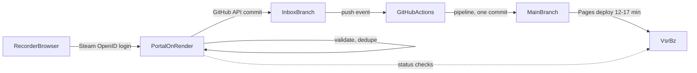

# Session upload portal

## How it works

- The portal never clones vsr.bz (8.6 GB tracked). It writes through the GitHub Git Data API: blobs, one tree, one commit, one new ref `inbox/<utc>-<Folder>-<id>` per upload batch.
- The workflow triggers on `inbox/**`, checks out `main` sparsely (about 4.5 GB: `scripts`, `data/sessions`, `data/processed`, `data/render`, `data/maps`, `data/external`, `player`, `map`), copies the uploaded files in, and runs `python scripts/process_stats.py --no-sync --no-prompt`.
- It pushes sessions and processed output to `main` as one commit, then deletes the inbox branches it consumed. `main` therefore only ever receives sessions the full pipeline has already processed, a bad file cannot break your local runs, and each batch costs one Pages build instead of two.
- The portal keeps no database. Login is a signed cookie; pending uploads are the inbox branches; history is the git log; "live" is the match id appearing in `https://vsr.bz/data/processed/matches.json`. That is what makes Render's free tier (no disk, sleeps when idle) workable.
- Expected time from upload to live: about 20-25 minutes, most of it the Pages deploy.

## Facts this rests on (checked in the repo)

- All 390 files in `data/sessions/` have a filename equal to the header's `start_time` in UTC, the same value [scripts/process_stats.py](scripts/process_stats.py) turns into the match id. The portal names files itself and ignores the uploaded filename.
- Each submitter folder maps to exactly one `author_steam64` (Sev, Nomad, VTrider, Cyber), so "logged-in account recorded this file" is enforceable.
- Every file uses config mod `1325933293.cfg`, a `.bzn` map, and tick rate 20, 30 or 60.
- Loading the whole processed cache takes 1.6 GB of RAM and 9 seconds locally, well inside a free Actions runner.
- The pipeline already collapses two recordings of one game and credits both submitters (`collapse_duplicate_recordings`), so the portal only needs to block exact re-uploads.

## What I build in `/portal`

- **App**: FastAPI + Jinja templates, `portal/app/`. `portal/render.yaml` deploys it as a free Render web service; `SESSION_SECRET` is generated by Render.
- **Steam login** (`app/steam_openid.py`): OpenID 2.0 redirect, server-side `check_authentication` call to Steam, claimed-id and return-URL checks, nonce freshness. No Steam API key needed.
- **Allowlist** (`portal/allowlist.json`): Steam64 to sessions folder, plus an `admin` flag. Seeded with the four recorders above. A signed-in account that is not listed sees its own Steam64 with a copy button, so adding someone is one line.
- **Validator** (`app/validator.py`), streaming so the 109 MB raw worst case fits in 512 MB:
  - size cap 64 MB (corpus max 26 MB), single gzip member, CRC intact, inflate cap, no trailing bytes
  - header first, every event decodes; unknown event types warn but never block, so a stale descriptor copy cannot stop uploads
  - `start_time` plausible; `author_steam64` valid, allowlisted, and equal to the signed-in account (admins may upload for another allowlisted recorder)
  - VSR config mod, non-empty map, sane tick rate, at least one `update_tick`, at least 2 valid Steam64s, duration at least 60 s
- **Duplicate checks** (`app/github_repo.py`): git blob SHA against every file under `data/sessions/` on `main` and in pending inbox branches; same path with different bytes; recordings the pipeline already removed per `data/duplicate_recordings.json`. A second recording of an existing game is accepted with a notice.
- **Pages**: multi-file upload (select the whole statsgate folder; a name and size pre-check skips files already published), per-file result with map, start time, duration and player count, a status timeline (Queued, Waiting for rebuild, Processing, Deploying, Live with a match link), and a small admin view with a kill switch indicator.
- **Limits**: 20 files per batch, 60 per user per day, `UPLOADS_ENABLED` kill switch, origin check on POST.
- **Tests**: the validator must accept all 390 existing sessions and reject synthetic bad files (truncated, trailing bytes, wrong author, wrong mod, future date); OpenID and GitHub calls are tested against mocked HTTP. A dry-run mode writes would-be commits to a local folder.
- **Runbook**: `portal/README.md` with deploy steps, environment variables, and how to handle a failed run.

## Changes in the vsr.bz repo

- Now: add `/portal` to [.gitignore](.gitignore), matching how `/statsgate` and `/f9bomber` are handled, so the portal is its own git repo and Pages never serves it.
- At rollout, on your go-ahead: `.github/workflows/process-uploads.yml` and `scripts/ci_uploads.py`, drafted first in `portal/integration/`. The helper:
  - takes only paths matching `data/sessions/<Folder>/<timestamp>.binpb.gz` from an inbox commit
  - waits instead of failing when any published match JSON is stamped with a different pipeline version than the code (a `PIPELINE_VERSION` bump whose reprocessed output is not on `main` yet): it writes nothing to `main`, keeps the inbox branches, and marks their commits with a pending status that the portal shows as waiting for a rebuild
  - after the pipeline, requires every uploaded session to be published or receipted as a duplicate, and only `data/`, `player/`, `map/` to have changed
  - on a rejected push, rebases if `main` moved outside those paths, otherwise resets and reruns
- Workflow triggers: a push to `inbox/**`; a push to `main` that changes `data/processed/matches.json` (your reprocessed output arriving), which publishes everything queued and repairs a manifest that is missing a session; and a manual run.
- Manual inputs: a dry run that runs the pipeline on `main` without pushing and reports whether `elo_history.json`, `matches.json` and `match_contributions.json` come out byte-identical on Linux (this runs before anything is allowed to push), and a full rebuild that reprocesses the whole corpus in Actions when you would rather not do it locally (estimated 30-45 minutes, not measured).
- At rollout, on your go-ahead: a `.gitattributes` rule that keeps your copy of generated files in a merge. It covers `data/processed/**` except `player_slugs.json`, plus the `player/*/index.html` and `map/*/index.html` stubs.
- After go-live: link the portal from [record/index.html](record/index.html) and update [README.md](README.md), [DEVELOPER_GUIDE.md](DEVELOPER_GUIDE.md) and [.cursor/rules/project-overview.mdc](.cursor/rules/project-overview.mdc).

## Reprocessing with new logic

Generated files are never merged, only rebuilt.

- An upload is one new file on its own branch, so it cannot conflict with anything on `main`.
- The workflow always starts from the tip of `main` and runs the pipeline code it finds there. If `main` moves mid-run in `scripts/` or `data/`, it discards its result and reruns.
- Two of the last three `PIPELINE_VERSION` bumps reached `main` before their reprocessed JSON (22 minutes and about 15 hours apart), so a mid-reprocess `main` is a normal state. The workflow waits through it and catches up when `matches.json` changes on `main`.
- Pushing the version bump first is therefore a pause switch: nothing publishes until your output is up, and your output push cannot collide with the workflow.
- If the workflow publishes while you are reprocessing locally with logic you have not pushed, your push is rejected. Commit, pull (the merge rule keeps your generated files and brings in the new raw sessions), rerun the pipeline (it only processes what arrived), push.
- The full rebuild in Actions is manual only. No match in the current corpus trips the alias stop, so it would run unattended today.

## What you do yourself

1. Create an empty GitHub repo for the portal and push `/portal` to it.
2. Create a fine-grained personal access token limited to `sevsunday/vsr.bz`: Contents read and write, Actions read. Set an expiry and a reminder.
3. In Render: New, Blueprint, pick the portal repo, set `GITHUB_TOKEN` and `PUBLIC_BASE_URL`, deploy.
4. Optional: add a CNAME such as `upload.vsr.bz` pointing at the Render service. The `onrender.com` address works until then.
5. Run the dry-run from the Actions tab once the workflow is in, and look at the summary with me.
6. Run `git config merge.ours.driver true` once in your vsr.bz clone so the merge rule takes effect. Without it, git falls back to its normal merge and you resolve generated-file conflicts by hand as you would today.
7. Confirm the four seeded recorders and add anyone else.
8. Do the first real upload yourself and watch it go live.
9. Ongoing: commit before you `git pull`, and rerun the pipeline after any pull that brought in sessions, since Actions now also writes `data/processed/`; run the pipeline interactively now and then to sign off outcomes; renew the token.

## Defaults I chose (say if any is wrong)

- Uploads from allowlisted recorders publish without an approval step.
- Minimum match length of 60 seconds. Three of the 390 published matches are shorter, so set it to 0 if you want today's behaviour.
- Legacy pre-v3 files are accepted from admins only.

## Known limits

- The collector does not sign files. The portal proves which Steam account uploaded a file claiming to be its own recording, not that the contents are untouched. The curated list is the safeguard.
- A match on a map with no existing 3D extract shows an empty Replay tab until you run the pipeline locally, because the extract needs the Steam install.
- Outcome sign-off stays with you. Matches publish with the host's attested result; unclear ones stay unrated until you adjudicate.
- Uploads that arrive while `main` is mid-reprocess wait until your output is pushed. On one recent bump that would have been about 15 hours.
- `player_slugs.json`, `data/duplicate_recordings.json` and `data/match_outcome_adjudications.json` hold state that cannot be regenerated. If you and the workflow both add entries to one of them in the same window, that needs a hand merge. The validator's run history loses the workflow's rows for such a window.
- The dual-presence alias stop exits non-zero under `--no-prompt`. The run fails, the inbox branch is kept, and GitHub emails you.
- Whether a push made with the workflow's built-in token triggers the Pages build is unverified. If the first run does not deploy, the fix is to push with the access token instead.
- Render's free tier takes 30-60 seconds to wake after 15 idle minutes.
