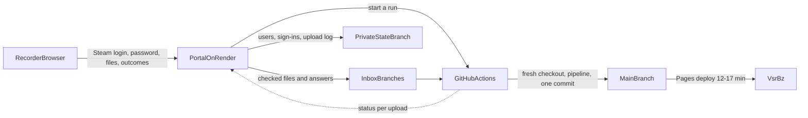

# Session upload portal

Everything here is built in `/portal` (which becomes `sevsunday/stats-portal`), except the items under "Changes in the vsr.bz repo" and "What you do yourself".

## How it works

- The portal at `upload.vsr.bz` signs recorders in, checks files, asks for outcomes and queues uploads on `inbox/*` branches of vsr.bz. It never runs the pipeline and cannot write to `main`.
- Processing runs in GitHub Actions inside vsr.bz and publishes raw sessions, outcomes and processed output as one commit. Upload to live takes about 25 minutes, most of it the Pages deploy.
- Render's free tier has no disk, sleeps after 15 idle minutes (about a minute to wake), and its free Postgres expires after 30 days, so everything lasting is stored in GitHub.
- Stack: FastAPI, Jinja templates, no CDN assets, a `render.yaml` blueprint.

## Processing always uses the latest pipeline

- Every run starts from a fresh checkout of the current `main` and runs [scripts/process_stats.py](scripts/process_stats.py) from it, so a change you push is used by the next upload. There is no server copy that can fall behind.
- Before pushing it checks `main` again. If `main` moved, it discards its result and starts over from the new tip, up to three times.
- The checkout is the whole repo except `data/models`, `data/lego` and `data/audio` (2.9 GB of viewer assets). None of the pipeline's 30 modules reference those three. They do read outside `scripts/` and `data/`: `_map-analysis/vsrmaplist` for new-map 3D extracts, `js/bz2api.js`, `critique/decisions`. A full checkout (8.6 GB of files plus git's own copy) is too tight for the runner's 14 GB disk.
- The run stops if a pipeline module starts referencing an excluded folder. Python and protobuf are pinned to your local versions.

## Sign-in and access

- **Steam**: OpenID 2.0, verified server-side with Steam, bound to `https://upload.vsr.bz`.
- **Submitter list**: Steam64 to sessions folder and role, edited in the admin dashboard, seeded with Sev (admin), Nomad, VTrider and Cyber. Any other account sees "not approved" with its Steam64 and never reaches the password form.
- **Password**: an approved account is asked once to "Enter the password you use to access the BZCC devtest branch". The portal holds only a salted hash in a Render environment variable. The check is remembered per Steam account for 90 days, across browsers, and is asked again at once if the password changes. Five wrong tries lock that account for 15 minutes.
- **Sessions**: 30 days, signed HttpOnly cookie, CSRF token and origin check on every POST, strict content security policy.

## Upload checks

- **Request**: one file per request, 64 MB cap enforced while streaming, browser-supplied name and type ignored, 20 files per batch, 60 per user per day.
- **Container**: the 10-byte gzip header must equal the one all 390 existing files share; single member, checksum and length verified, inflate cap, no trailing bytes.
- **Wire format**: header first and exactly once, nothing else at top level but events. Decoded in 4 MB slices against the descriptor of its own schema era (v1 to v5); any unknown field or event type fails. Descriptors are read from the `statsgate*_pb2.py` files on `main` as data, never executed, so a schema change needs no portal redeploy.
- **Header**: VSR config mod, `.bzn` map, allowed tick rate (20, 30 or 60 today), start time between the first corpus game and now, `last_tick` matching the stream, enums in range.
- **Stream**: tick order within a small tolerance, update-tick count against length, at most 10 players per tick, at least 2 valid Steam64s, at least 60 seconds, well-formed ODF names of which at least 90% exist in `data/odf.min.json`, bytes and events per tick inside the corpus range.
- **Identity**: `author_steam64` is the signed-in account and that account appears in the game. Admins may upload for another approved recorder.
- **Duplicates and removals**: blob SHA against `data/sessions/` on `main` and queued uploads, the pipeline's duplicate receipt (`data/duplicate_recordings.json`), and a block list of anything an admin removed. The block list starts with the five VTrider recordings reverted on Nov 21.
- **Path**: the server builds `data/sessions/<Folder>/<start_time>.binpb.gz` itself. A new folder name is accepted only if Windows and Linux sort the folder list the same way.
- **In Actions**: only that path shape is accepted from an inbox branch, and the real pipeline must process the file before it reaches `main`. A batch that breaks the pipeline moves to `quarantine/` and the rest still publish.
- Measured so far: all 390 files share one gzip header. On 15 files across all five schema eras the strict decode, the `last_tick` rule and the recorder-in-game rule all hold, and the largest file (26 MB) checks in about 2 seconds locally. The other thresholds are set from the full corpus during the build, and the test suite requires all 390 sessions to pass and synthetic bad files to fail.

## Outcome confirmation

- Each uploaded game shows what the console prompt in [scripts/adjudication.py](scripts/adjudication.py) shows: map, start, duration, both teams with commanders and factions, the host's in-game answer, the kill-feed evidence and the current resolution.
- Choices: Team 1 win, Team 2 win, Draw, Game cancelled, or I don't know. The current resolution is preselected. Void and defer are not offered.
- An answer is final. Actions writes it to `data/match_outcome_adjudications.json` with the pipeline's own `make_entry`, where it outranks the host's answer and the kill-feed evidence, and the console never asks about that game again. "I don't know" writes nothing: the game publishes on its interim result and the console prompt still reaches you.
- The preview is a small port of the pipeline's roster and winner logic, tested against every published match. The answer is stored with the commander it referred to and applied only when the pipeline's own roster agrees.
- A second recording of a game that already has a signed-off outcome is not asked. If two submitters answer differently, the published recording's answer stands and both are flagged.
- An answer that contradicts the host or clean-win evidence is applied and listed in the admin dashboard. Corrections work as today: edit the JSON and rerun.

## Dashboards

- **Submitter, read-only**: every game from their folder, including ones from before the portal, with map, date, duration, players, commanders, outcome, a link to the match and a status (Queued, Waiting for rebuild, Processing, Deploying, Live, Merged into another recording, Needs attention). Rejected files show the reason. Uploading is the only action.
- **Admin, for admin Steam accounts**:
  - Health: credentials, password set, kill switches, `main` tip, pipeline code version against published data version, sessions against manifest, recent workflow runs and Pages builds.
  - Submitters: add, disable, change folder, reset the password check; last sign-in and upload counts.
  - Sign-ins and audit log: every sign-in (approved, not approved, locked), password attempt, upload, rejection and admin action. IP addresses are kept only as salted hashes.
  - Git: recent commits on `main` marked portal or manual with what they touched, queue and quarantine branches, publish history.
  - Outcome flags and conflicting answers.

## It never pushes unless the result is clean

The workflow publishes only as a fast-forward of the current `main`. It never merges generated files and never force-pushes. When it cannot publish it writes nothing, keeps the upload queued, sets a status the dashboards show, and opens or updates one GitHub issue so you get an email.

- **`main` moved during the run**: start over from the new tip, three tries.
- **Pipeline code newer than published data** (a `PIPELINE_VERSION` or rating schema bump without its output): wait. Pushing your output releases the queue; so does the full rebuild in Actions.
- **Sessions on `main` missing from the manifest** (for example a pull and push without a rerun): repaired by the next run, which also starts whenever `matches.json` changes on `main`.
- **Pipeline fails on an upload** (a crash, or the dual-presence stop in `scripts/identity_aliases.py`): that batch is quarantined.
- **Unexpected result** (files changed outside `data/`, `player/`, `map/`; many existing matches rewritten; an uploaded session neither published nor receipted): stop.
- **Same path already on `main` with other bytes, or an outcome already recorded there**: `main` wins and the upload is flagged.
- **History rewritten on `main`**: each upload is a commit with no parent that is copied, never merged, so it still applies.
- **Credential expired, workflow missing, Actions down**: uploads stay queued and the health panel says why.
- **Admin actions**, all logged: retry, dry run without pushing, full rebuild, quarantine, release or delete an upload, remove a published session and block its re-upload, pause or resume uploads, pause or resume publishing.

## Where things are stored

- `sevsunday/stats-portal`, `main`: the portal code that Render deploys.
- `sevsunday/stats-portal`, `state` branch: submitters, password checks, sign-in and audit log, upload records, block list, settings. The repo is public today and has to be private for this.
- vsr.bz, `inbox/*` and `quarantine/*`: queued uploads, each holding only the uploaded files and a small batch record.
- vsr.bz, `main`: one publish commit per batch whose message lists each file, match id, result and outcome.
- Render environment: session secret, password hash, admin Steam64, GitHub App key, `UPLOADS_ENABLED` kill switch.

## GitHub credentials

- The portal uses a GitHub App with contents and actions permission and no workflow permission, installed on both repos. It does not expire. A personal token works in its place for local testing.
- A ruleset on `main` in both repos lets only repository admins update it, so a leaked portal credential can queue files but cannot change the site.
- The workflow runs only from `main` (started by the portal, or by a `matches.json` change), never from an inbox branch.
- It pushes with a fine-grained token of yours kept in an Actions environment limited to `main`. GitHub's docs state that pushes made with the workflow's built-in token do not start a Pages build. The health panel warns before that token expires.

## Changes in the vsr.bz repo

- Now: add `/portal` to [.gitignore](.gitignore).
- At rollout, on your go-ahead, drafted first in `portal/integration/`: `.github/workflows/process-uploads.yml`, `scripts/ci_uploads.py`, and a `.gitattributes` rule that keeps your copy of generated files in a merge (`data/processed/**` except `player_slugs.json`, plus the player and map stubs).
- The workflow has manual modes: dry run, full rebuild, repair and remove. The dry run reports whether `elo_history.json`, `matches.json` and `match_contributions.json` come out byte-identical on Linux, and it runs before anything is allowed to push.
- After go-live: link the portal from [record/index.html](record/index.html) and update [README.md](README.md), [DEVELOPER_GUIDE.md](DEVELOPER_GUIDE.md) and [.cursor/rules/project-overview.mdc](.cursor/rules/project-overview.mdc).

## What you do yourself

1. Make `sevsunday/stats-portal` private. I push `/portal` to it when you say so.
2. Create the GitHub App (the runbook lists the exact fields), install it on both repos and download its key.
3. In Render: New, Blueprint, pick the repo, then paste the App key, your Steam64 as admin and the password hash (a helper command prints it).
4. Add `upload.vsr.bz` as a custom domain in Render and point a CNAME at the service.
5. In vsr.bz settings: add the ruleset on `main`, create the `publish` environment limited to `main`, and store the publish token in it.
6. Run `git config merge.ours.driver true` once in your vsr.bz clone so the merge rule takes effect.
7. Run the dry run with me, confirm the submitter list, and do the first real upload.
8. Ongoing: commit before you `git pull`, and rerun the pipeline after a pull that brought in sessions.

## Defaults I chose (say if any is wrong)

- Uploads from approved recorders publish without an approval step.
- The password is asked again after 90 days; a sign-in lasts 30 days.
- Minimum match length of 60 seconds. Three published matches are shorter.
- Recordings from any schema era are accepted if they pass their own era's checks.
- The five reverted VTrider recordings stay blocked until you unblock them.

## Known limits

- The collector does not sign files and every session is public, so the checks prove a file is a well-formed statsgate recording uploaded by its recorder, not that the game happened as recorded. The curated list is the safeguard. The devtest password is a community check: anyone can copy it from [beta/index.html](beta/index.html).
- A final answer from a submitter can overrule clean-win evidence. Those cases are listed for you, not blocked.
- Uploads that arrive while `main` is mid-reprocess wait until your output is pushed (about 15 hours on one recent bump).
- `player_slugs.json`, `data/duplicate_recordings.json` and `data/match_outcome_adjudications.json` hold state that cannot be regenerated. If you and the workflow both add entries in the same window, that needs a hand merge.
- A recording from a newer collector schema is rejected until `scripts/statsgate.proto` on `main` knows it. An admin setting can relax that during a transition.
- Not tested yet: output parity between Linux and your Windows runs, a 26 MB file through the GitHub API, and 3D extracts for new maps on Linux (the map sources are tracked, so they should build). The dry run and an early upload test cover all three.
