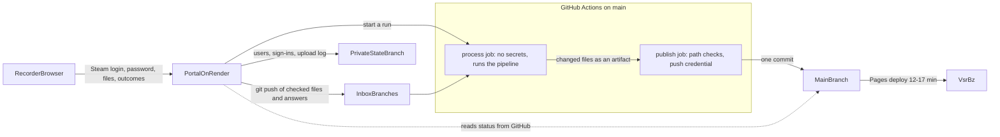

# Session upload portal

## How it works



- The portal at `upload.vsr.bz` signs recorders in, checks files, asks for outcomes and queues uploads on `inbox/*` branches of vsr.bz. It never runs the pipeline and cannot write to `main`.
- Processing runs in GitHub Actions inside vsr.bz and publishes everything queued as one commit. Upload to live takes about 25 minutes, most of it the Pages deploy.
- The portal reads status from GitHub (queue branches, commit statuses, workflow runs, Pages builds, `main`), cached for about a minute. Actions never calls the portal.
- Render's free tier (512 MB, 0.1 CPU) has no disk, sleeps after 15 idle minutes (about a minute to wake), and its free Postgres expires after 30 days, so everything lasting is stored in GitHub.
- Stack: FastAPI, Jinja templates, no CDN assets, a `render.yaml` blueprint.

## Where it is built

- Everything is built in `/portal` at the root of this workspace. It is its own git repository with `sevsunday/stats-portal` as its remote, and it is listed in vsr.bz's [.gitignore](.gitignore), so vsr.bz never commits it and Pages never publishes it.
- Files meant for vsr.bz are drafted in `portal/integration/` and copied into vsr.bz only on your go-ahead (see "Changes in the vsr.bz repo"). Nothing else is written outside `/portal`.

```
portal/
  app/           sign-in, file checks, game preview, queue, state, dashboards
  templates/     pages
  static/        the site's theme files (copied) and the portal's own CSS and JS
  tools/         password hash helper, site theme sync
  tests/
  integration/   files for vsr.bz, installed only on your go-ahead
  render.yaml, requirements.txt, README.md
```

## Look and theme

- **Same styles**: the portal ships copies of the site's five shared stylesheets, Bootstrap, Bootstrap Icons, the Geist fonts and [js/theme.js](js/theme.js), in the same folder layout. Its pages use the site's navbar, cards, tables and badges and follow [.cursor/rules/styling.mdc](.cursor/rules/styling.mdc): Bootstrap first, `--kb-*` colors only, no inline style blocks, no CDN.
- **Same themes**: all 44 themes, light and dark, with the same palette menu.
- **Copies, not links**: `tools/sync_site_theme.py` copies the files and records the vsr.bz commit they came from; the admin health panel says when the site's theme files have changed since. The portal loads no CSS or script from `vsr.bz` at run time, so the main site cannot run script inside the portal and a Pages outage cannot unstyle it.
- **Carry-over**: browser storage is not shared between `vsr.bz` and `upload.vsr.bz`. `js/theme.js` therefore gets a small addition, on your go-ahead: it also writes the chosen theme and mode to a cookie on `vsr.bz` that both sites can read, and on load adopts the cookie when that is the newer choice. The portal reads the cookie on the server, so a page arrives already in that theme, and a change on either site carries to the other. One file reaches the whole site: 27 of 28 shells and both stub templates load it.
- Someone who has not visited the main site since that change sees the default theme on the portal until they pick one.
- **Navigation**: the VSR brand links back to `vsr.bz`. The bar holds the portal's own pages (Upload, My games, Admin), the palette menu and the account menu. The full site menu is not copied.
- The theme cookie can be set by any script on `vsr.bz`, so the portal accepts only known theme ids from it.

## Processing always uses the latest pipeline

- Every run starts from a fresh checkout of the current `main` and runs [scripts/process_stats.py](scripts/process_stats.py) from it, so a change you push is used by the next upload. There is no server copy that can fall behind.
- `main` is checked again when processing finishes and once more at the push. If it moved, the run starts over from the new tip, up to three times.
- The checkout is shallow and blob-filtered (what `actions/checkout` does in sparse mode) and covers the whole repo except `data/models`, `data/lego` and `data/audio`. None of the pipeline's 30 modules reference those three. They do read outside `scripts/` and `data/`: `_map-analysis/vsrmaplist` for new-map 3D extracts, `js/bz2api.js`, `critique/decisions`.
- By my estimate that checkout needs about 10.5 GB of the runner's 14 GB today and grows about 17.5 MB per session, which leaves room for roughly 200 more sessions. The job therefore frees the runner's unused preinstalled SDKs first and stops early with a clear message if space is short. The dry run logs free disk before and after.
- Python and packages are pinned to your machine's versions (Python 3.13, protobuf 6.33, numpy 2.3, Pillow 12). The run stops if a pipeline module starts referencing an excluded folder.

## Sign-in and access

- **Steam**: OpenID 2.0, verified server-side with Steam. Every login checks Steam's endpoint, our exact return URL, that the signed field list covers the claimed id, identity, return URL, nonce and association handle, the claimed-id pattern, nonce freshness and replay, and a short-lived login state cookie.
- **One address**: the return URL and the origin check come from a configured base URL, never from request headers. Any other host, including the service's own `onrender.com` address, is redirected or refused. After sign-in the portal only redirects to its own pages.
- **Submitter list**: Steam64 to sessions folder and role, edited in the admin dashboard, seeded with Sev (admin), Nomad, VTrider and Cyber. Any other account sees "not approved" with its Steam64 and never reaches the password form.
- **Password**: an approved account is asked once to "Enter the password you use to access the BZCC devtest branch". The portal holds only an scrypt hash in a Render environment variable and compares in constant time. The check is remembered per Steam account for 90 days, across browsers. A password change is detected by a keyed fingerprint (the hash itself is never stored with the accounts) and everyone is asked again at once. Five wrong tries lock that account for 15 minutes.
- **Sessions**: 30 days in a `Secure`, `HttpOnly`, `SameSite=Lax` signed cookie. Every request re-checks the submitter's current status, so disabling someone or resetting their password check takes effect at once. CSRF token and origin check on every POST, and a content security policy that allows scripts only from the portal itself.
- **Same site as vsr.bz**: a browser treats `vsr.bz` and `upload.vsr.bz` as one site, so the portal does not rely on SameSite. Its cookies use the `__Host-` prefix, which the main site cannot set or overwrite, every change is a POST with a token and an exact origin check, and it sends no CORS headers.

## Upload checks

- **Before sending**: the page skips files the site already has (same name and size in the recorder's folder) and files that are not gzip, so selecting the whole statsgate folder sends only new games. The server still checks everything.
- **Request**: one file per request, 64 MB cap enforced while streaming (the largest so far is 26 MB; 64 MB covers three hours at 30 Hz), browser-supplied name and type ignored, 20 files or 300 MB per batch, 60 files per user per day.
- **Limits per schema version**: the size cap and the per-tick ranges are admin settings kept per collector schema version, so a denser future format needs no code change. The cap can go up to GitHub's 100 MiB file limit.
- **Isolation**: each file is checked in a short-lived worker process with a memory and a time limit, one at a time, so a hostile file cannot take the web process down or starve it. The memory limit is enforced by the portal watching the worker's real memory use, because an address-space limit can reject valid files.
- **Container**: the 10-byte gzip header must equal the one all 390 existing files share; single member, checksum and length verified, inflate cap and expansion-ratio cap enforced while streaming, no trailing bytes.
- **Wire format**: header first and exactly once, nothing else at top level but events. Decoded in 4 MB slices against the descriptor of its own schema era (v1 to v5); any unknown field or event type fails. Descriptors are extracted from the `statsgate*_pb2.py` files on `main` with `ast` as data, never imported or executed, so a schema change needs no portal redeploy.
- **Header**: VSR config mod, `.bzn` map with a strict name pattern, allowed tick rate (20, 30 or 60 today), start time between the first corpus game and now, `last_tick` matching the stream, enums in range.
- **Stream**: tick order within a small tolerance, update-tick count against length, at most 10 players per tick, at least 2 valid Steam64s, at least 60 seconds, well-formed ODF names of which at least 90% exist in `data/odf.min.json`, bytes and events per tick inside the range for that schema version.
- **Nicknames**: no control characters, at most 64 characters. Quotes and angle brackets stay allowed, because real names use them (`Raxion "Shadowthief"`, `Ashleyyyy<3`); the site's escaping is what has to handle them.
- **Identity**: `author_steam64` is the signed-in account and that account appears in the game. Admins may upload for another approved recorder.
- **Duplicates and removals**: blob SHA and path against `data/sessions/` on `main`, against queued uploads and within the batch; the pipeline's duplicate receipt (`data/duplicate_recordings.json`); and a block list. A recording an admin removed, or one that was published and later disappears from `main` (a manual revert), is blocked until you unblock it. The list starts with the five VTrider recordings reverted on Nov 21.
- **Held for you**: an upload goes to `held/*` and waits for an admin to approve or delete it in three cases. Approval is switched on, globally or for that submitter (off by default). The recording contains both accounts of a silent alias, which the pipeline would stop on. Or it starts in the same second as another recorder's published match without being the same game, which would give two matches one id.
- **Path**: the server builds `data/sessions/<Folder>/<start_time>.binpb.gz` itself. Folder names are ASCII letters, digits, `_` and `-`, unique ignoring case, never a reserved Windows name such as `CON` or `AUX`, and fixed once the recorder has an upload. The add-submitter form suggests one from `data/steamid_to_name.txt`.
- Measured so far: all 390 files share one gzip header. On 15 files across all five schema eras the strict decode, the `last_tick` rule and the recorder-in-game rule all hold, and the largest file (26 MB) checks in about 2 seconds locally. The other thresholds are set from the full corpus during the build, and the test suite requires all 390 sessions to pass and synthetic bad files to fail.

## Upload handling on Render's free tier

- Files are streamed to temporary disk, never held in memory. A checked file is stored once, inside the batch's scratch git repository, so a batch never takes more than its own size on disk.
- A batch is pushed with `git` itself (available in Render's Python runtime) as a commit with no parent, so nothing is base64-encoded or buffered. The access token reaches git through an askpass helper, never in a URL, an argument or a config file. The GitHub API route stays as a fallback.
- Staged batches wait until the outcomes are submitted. The page pings the server while someone is active on it, and stops after 30 minutes without activity, so the service does not sleep mid-upload and an abandoned tab cannot keep it awake.
- Staging has a global size cap, is deleted right after the push, and is cleared after 30 minutes otherwise. If a restart clears it sooner, the page says so, and re-sending the same files keeps the answers already chosen.
- This path is tested first on a real free instance with the largest corpus file, including free temporary disk and the memory limit, before the rest is built on it.

## Outcome confirmation

- Each uploaded game shows what the console prompt in [scripts/adjudication.py](scripts/adjudication.py) shows: map, start, duration, both teams with commanders and factions, the host's in-game answer, the kill-feed evidence and the current resolution.
- Choices: Team 1 win, Team 2 win, Draw, Game cancelled, or I don't know. The current resolution is preselected. Void and defer are not offered.
- An answer is final. Actions writes it to `data/match_outcome_adjudications.json` with the pipeline's own `make_entry`, where it outranks the host's answer and the kill-feed evidence, and the console never asks about that game again. "I don't know" writes nothing: the game publishes on its interim result and the console prompt still reaches you.
- The preview is a small port of the pipeline's roster and winner logic, tested against every published match. The answer is stored with the commander it referred to and applied only when the pipeline's own roster agrees.
- A second recording of a game that already has a signed-off outcome is not asked. If two submitters answer differently, the published recording's answer stands and both are flagged.
- An answer that contradicts the host or clean-win evidence is applied and listed in the admin dashboard. To correct one, edit `data/match_outcome_adjudications.json` on GitHub or locally: a push of that file starts a run that applies it. Setting `void` there takes a real game out of the ratings.

## Dashboards

- **Submitter, read-only**: every game from their folder, including ones from before the portal, with map, date, duration, players, commanders, outcome, a link to the match and a status (Queued, Waiting for approval, Waiting for rebuild, Processing, Deploying, Live, Merged into another recording, Needs attention). Rejected files show the reason. Uploading is the only action.
- **Admin, for admin Steam accounts**:
  - Health: credentials, password set, kill switches, `main` tip, pipeline code version against published data version, sessions against manifest, recent workflow runs and Pages builds, a warning when an upload passes 50 MiB, and a notice when the site's theme files have changed.
  - Submitters: add, disable, set the folder, require approval, reset the password check; last sign-in and upload counts.
  - Sign-ins and audit log: approved sign-ins, password attempts, uploads, rejections and admin actions in full; sign-ins by accounts that are not approved as a summary per account.
  - Git: recent commits on `main` marked portal or manual with what they touched, queue, held and quarantine branches, publish history.
  - Outcome flags and conflicting answers.

## The publishing workflow

- **Triggers**: started by the portal, by a push to `main` that changes `data/processed/**` or `data/match_outcome_adjudications.json`, and by an hourly sweep that exits in seconds when nothing is queued. A start request names no batch: every run takes everything queued. It never runs from an inbox branch. Runs are serialized and never cancelled mid-run, and a run caused by the workflow's own publish commit exits at once.
- **Pacing**: portal publishes are at least 20 minutes apart. A run that starts inside that gap waits it out before checking out `main`, then publishes everything queued by then as one commit, so a burst of uploads costs one Pages build and does not cancel the one before it. Pages has a soft limit of 10 builds an hour; your busiest hour in the last two weeks had 4.
- **`process` job**: no secrets and a read-only token. It checks out `main`, copies in the queued files (regular files of the one allowed path shape only), runs the pipeline twice (the second pass applies the outcomes), starts over in place if `main` moved meanwhile, then packs the changed files, the deletions and a result record into an artifact. When only timestamps would change, nothing is published.
- **`publish` job**: runs only when there is something to publish and is the only job with the push credential. It never parses a recording, runs no pipeline code, installs nothing, restores no cache and needs no working copy: the artifact is unpacked outside the repository and the commit is built directly on `main`'s tree. It refuses the artifact unless every path is on the output list, page stubs match their templates, rewrite counts are within bounds and `main` has not moved.
- **Sessions are protected**: an existing session file can never be modified. It can be deleted only when the same commit carries the pipeline's duplicate receipt for it, or in the admin's remove mode for the named file.
- **`report` job**: runs even when processing failed, with the workflow's built-in token. It moves failed batches to `quarantine/`, deletes inbox branches once their files are confirmed on `main`, sets the statuses, opens or updates the issue, and re-runs the workflow if `main` moved in the last moments before the push. It lists the queue itself, accepts only names of the expected form from the processing job, and puts error text into the issue truncated and inside a code block. A batch that fails three runs in a row is quarantined.
- **Output list**: sessions, `data/processed/**`, the adjudication, duplicate and joint-test files, map registry and images, render extracts, and the player and map stubs, confirmed by the dry run. Code, workflows and curated inputs such as `data/odf.min.json` and `data/steamid_to_name.txt` can never be written.
- **Hygiene**: untrusted values (branch names, file names, batch records) are never placed into workflow shell lines, and actions are pinned to commit SHAs.

## It never pushes unless the result is clean

The workflow publishes only as a fast-forward of the current `main`. It never merges generated files and never force-pushes. When it cannot publish it writes nothing, keeps the upload queued, sets a status the dashboards show, and opens or updates one GitHub issue so you get an email.

- **`main` moved during the run**: start over from the new tip, three tries.
- **Pipeline code newer than published data** (a `PIPELINE_VERSION` or rating schema bump without its output): wait. Pushing your output releases the queue; so does the full rebuild in Actions.
- **Sessions on `main` missing from the manifest** (for example a pull and push without a rerun): repaired by the next run.
- **Pipeline fails on an upload** (a crash, or the dual-presence stop in `scripts/identity_aliases.py`): that batch is quarantined and the rest still publish.
- **Unexpected result** (a path off the output list; many existing matches rewritten; an uploaded session neither published nor receipted): stop.
- **Same path already on `main` with other bytes, or an outcome already recorded there**: `main` wins and the upload is flagged.
- **History rewritten on `main`**: each upload is a commit with no parent that is copied, never merged, so it still applies.
- **A start was missed or a run failed for a passing reason** (Render restarted, Actions hiccup): the hourly sweep picks it up.
- **Credential expired, workflow missing, Actions down**: uploads stay queued and the health panel says why.
- **Admin actions**, all logged: retry, dry run without pushing, full rebuild, approve or delete a held upload, quarantine, release or delete an upload, remove a published session and block its re-upload, pause or resume uploads, pause or resume publishing.

## Where things are stored

- `sevsunday/stats-portal`, `main`: the portal code that Render deploys.
- `sevsunday/stats-portal`, `state` branch: submitters, password checks, audit log, upload records, block list, settings. The repo is public today and has to be private for this.
  - Changes that affect access or safety (submitter changes, password-check resets, lockouts, kill switches, the block list) and accepted uploads are written at once, and the page reports success only after the write is confirmed.
  - Routine log entries are batched into at most one commit every 30 seconds and flushed on shutdown. All writes use compare-and-swap with retry.
  - A request from an account that is not approved never causes a write. It is rate-limited, counted in memory, written to Render's log and summarized for the admin at most every 10 minutes.
  - IP addresses are stored only as a keyed hash whose key exists only in Render's environment.
- vsr.bz, `inbox/*`, `held/*` and `quarantine/*`: queued uploads, each holding only the uploaded files and a small batch record, from which the portal's upload records can be rebuilt. Inbox branches are deleted when they publish.
- vsr.bz, `main`: one publish commit per run whose message lists each batch, file, match id, result and outcome.
- Render environment: base URL, session secret, password hash, IP hash key, admin Steam64, portal App key, `UPLOADS_ENABLED` kill switch.

## GitHub credentials

- **Portal**: a GitHub App with contents and actions permission and no workflow permission, installed on both repos. It does not expire. A personal token works in its place for local testing.
- **Ruleset** on `main` in both repos: only repository admins and the publisher may update it, so a leaked portal credential can queue files but cannot change the site.
- **Publisher**: a second GitHub App with contents permission on vsr.bz only, on the ruleset's bypass list, its key kept in an Actions environment limited to `main`. It needs no yearly renewal. Statuses, quarantine moves and the issue use the workflow's built-in token, which the ruleset keeps off `main`.
- GitHub documents that a push made with the workflow's built-in token does not start a Pages build. Whether a push by an App does is checked in the early test. If it does not, a fine-grained token of yours takes the publisher's place and the health panel warns before it expires.

## Changes in the vsr.bz repo

- Now: add `/portal` to [.gitignore](.gitignore).
- At rollout, on your go-ahead, drafted first in `portal/integration/`:
  - `.github/workflows/process-uploads.yml` and `scripts/ci_uploads.py`.
  - A `.gitattributes` rule that keeps your copy of generated files in a merge (`data/processed/**` except `player_slugs.json`, plus the player and map stubs).
  - `scripts/merge_keyed_json.py`, a merge helper for the keyed state files (`data/match_outcome_adjudications.json`, `data/duplicate_recordings.json`, `data/processed/player_slugs.json`, `data/joint_test_ledger.json`). It unions them by key and stops only when both sides changed the same entry or allocated the same slug.
  - One line in `discover_sessions()`: an explicit case-insensitive sort key, the same order Windows gives today, so folder order cannot differ between your machine and Actions.
- Before go-live, on your go-ahead:
  - Quote escaping in the escape helpers of [js/app.js](js/app.js), [js/elo.js](js/elo.js), `js/meta.js`, `js/vtsr-explainers.js` and `js/highlights-render.js`. They leave quotes alone and feed more than 50 attribute values, among them player names in the match picker and the ELO table. One published game already has a nickname with double quotes in it.
  - The theme cookie addition in [js/theme.js](js/theme.js) (see "Look and theme").
- The workflow has manual modes: dry run, full rebuild, repair and remove. The dry run reports whether `elo_history.json`, `matches.json` and `match_contributions.json` come out byte-identical on Linux, and it runs before anything is allowed to push.
- After go-live: link the portal from [record/index.html](record/index.html), add an "Upload sessions" row to the Settings gear in [js/cursor-settings.js](js/cursor-settings.js) (one file reaches every page), and update [README.md](README.md), [DEVELOPER_GUIDE.md](DEVELOPER_GUIDE.md) and [.cursor/rules/project-overview.mdc](.cursor/rules/project-overview.mdc).

## Checks before go-live

- An existing session uploaded again is refused as already published.
- A new session goes from Queued to Live, with its outcome applied and its match link working once Pages has deployed.
- Two runs started back to back: the second makes no commit.
- A `PIPELINE_VERSION` bump pushed without its output makes an upload wait; pushing the output releases it.
- A published session removed with the admin action is gone after the next deploy and cannot be uploaded again.
- An account that is not approved is refused, and so is a Steam login made for a different return address.
- The portal opens in the theme chosen on the main site, and a change made on the portal shows on the main site.

## What you do yourself

1. Make `sevsunday/stats-portal` private. I push `/portal` to it when you say so.
2. Create the two GitHub Apps, portal and publisher (the runbook lists the exact fields), install them and download their keys.
3. In Render: New, Blueprint, pick the repo, then paste the portal App key, your Steam64 as admin and the password hash (a helper command prints it).
4. Add `upload.vsr.bz` as a custom domain in Render and point a CNAME at the service.
5. In vsr.bz settings: add the ruleset on `main` with the publisher on its bypass list, create the `publish` environment limited to `main`, and store the publisher key in it.
6. Run the two `git config` lines from the runbook once in your vsr.bz clone so the merge rules take effect.
7. Check that GitHub emails you about new issues on vsr.bz. That is how a stuck upload reaches you.
8. Run the early Render test and the dry run with me, confirm the submitter list, and do the first real upload.
9. Ongoing: commit before you `git pull`, and rerun the pipeline after a pull that brought in sessions.

## Defaults I chose (say if any is wrong)

- Uploads from approved recorders publish without an approval step. The approval hold exists and is off.
- The password is asked again after 90 days; a sign-in lasts 30 days.
- Minimum match length of 60 seconds. Three published matches are shorter.
- File cap of 64 MB, portal publishes at least 20 minutes apart, and an hourly sweep.
- Recordings from any schema era are accepted if they pass their own era's checks.
- The five reverted VTrider recordings stay blocked until you unblock them.
- The portal has its own short menu, not the full site menu.

## Compared with the October plan

Checked against `.cursor/plans/archive/pipeline/session_upload_automation_fa308965.plan.md`. None of it was ever built.

- **Carried over**: reserved Windows folder names and fixed folders; outcome and `void` edits on GitHub applied by a run; the local skip of files the site already has; alias and same-second cases held for you; its review mode as the optional approval hold; reverted recordings staying blocked; the Settings-gear link; nothing published when only timestamps change; its go-live tests.
- **Left out on purpose**:
  - Supabase storage and functions. The portal on Render and the inbox branches replace them.
  - Review pull requests. Uploads publish directly, and the approval hold covers the same need.
  - Any known player may upload. You chose a hand-picked list.
  - Folder names derived automatically. You assign them.
  - A 15-minute wait before every publish. The first batch goes at once and later ones are 20 minutes apart.
  - Mirroring VTrider's statsgate repo. It has had no new sessions since May 11, and all 55 of its files are already in `data/sessions/`.
  - A full reprocess in Actions after a version bump. It waits for you, as you chose.

## Known limits

- The collector does not sign files and every session is public, so the checks prove a file is a well-formed statsgate recording uploaded by its recorder, not that the game happened as recorded. The curated list is the safeguard. The devtest password is a community check: anyone can copy it from [beta/index.html](beta/index.html).
- A final answer from a submitter can overrule clean-win evidence. Those cases are listed for you, not blocked.
- If the processing job were ever compromised by a crafted file, it could still put false or hostile content into the pipeline's output files. It could not reach the push credential, code, workflows or curated inputs.
- I checked the site's escape helpers, not every place a name from a recording is rendered. A full audit of that is outside this plan.
- Uploads that arrive while `main` is mid-reprocess wait until your output is pushed (about 15 hours on one recent bump).
- The keyed state files still need a hand merge when you and the workflow changed the same entry in the same window.
- A recording from a newer collector schema is rejected until `scripts/statsgate.proto` on `main` knows it. An admin setting can relax that during a transition; it switches itself off after 7 days and shows a banner while it is on.
- GitHub blocks files over 100 MiB and Pages cannot serve Git LFS files, so a much denser collector format would need raw sessions stored outside the Pages repo. Where the raw file lives is kept behind one function in the portal and one in the workflow helper, so that move stays small.
- The published site is 9.2 GB against GitHub's documented 1 GB Pages limit, and the Pages build checks out all of it. If GitHub enforces that limit, publishing stops with or without the portal.
- Runner disk is the next ceiling for the workflow. If freeing SDKs is not enough, the replay tracks can be left out of the checkout, because the pipeline only writes them.
- GitHub may delay or drop a scheduled run under load, so the hourly sweep is a safety net, not a timer.
- Not tested yet: output parity between Linux and your Windows runs, the git push and the worker memory limit on a Render free instance, how much temporary disk that instance has, whether an App push starts a Pages build, how much disk the runner cleanup frees, and 3D extracts for new maps on Linux (the map sources are tracked, so they should build). The early test and the dry run cover all of them.
