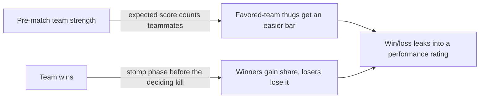

# VTSR-T: team strength and end-game damage

All numbers below come from read-only, in-memory runs on today's corpus (292 rated matches, about 1,920 thug rows). Nothing was written.

## Finding 1: team strength (worth fixing)

- **The bias.** A thug's result against expectation rises with how much stronger their teammates are than their opponents (slope +0.040 per 100 rating points of gap, z 4.0). In rating terms that is about +1.5 points per game per 100 points of gap.
- **It is concentrated at the weak end.** Thugs whose teams were at least about 80 points weaker (the bottom fifth of games) average -1.2 points per game. Every other fifth averages +3.4 to +4.8.
- **The cause** is in [scripts/elo.py](scripts/elo.py). The reference for the expected score is the median of everyone else in the lobby, teammates included (`others`, built at about lines 1317-1325 and 1758-1765). Strong teammates raise that median, which lowers your bar.
- **Team balancing makes it systematic.** Own rating correlates -0.32 with the team gap, because strong players are paired with weaker teammates. So strong carriers pay and weaker players get lifted. A straight-line estimate of the career effect runs from about -73 points (Domakus) to about +150 (judgeguns). That is an overestimate given how uneven the effect is; a full re-rate will give the real figure.
- **Controls:**
  - With own rating held fixed, the gap slope is still +0.030 (z 2.8).
  - Once the match result is known, the gap stops helping (-0.034, z -3.7). So it works entirely through win probability, which is what a pre-match expectation is supposed to absorb.
- **Likely fix: an opponents-only reference.** Re-scoring expectations with the median of the enemy team only removes the slope (+0.001, z 0.1), at the same overall fit (mean |P-E| 0.345 against 0.346). This was never tested: Phase 2C compared only median, max and softmax over the whole lobby.
- **Side note, out of scope:** the lowest rating deciles beat expectation by +0.115 and +0.083, so the bottom of the ladder is under-expected. Report it in the study; don't fix it here.

## Finding 2: end-game damage (affects ratings, but not after the win condition)

- **The effect of building damage in the last 180 s** (`enemy_structure_dealt_late`):
  - Winning thugs gain +2.4 per game from it and losing thugs lose -2.5.
  - 672 of 1,921 thug rows move by more than 5 points, and 10.7% change direction.
  - Career effect for the 24 regulars ranges from -87 (Snake) to +64 (Monkey).
  - 5 regulars would change half-tier: Snake and Muffin up, Monkey, The Wanderer and Darkvale down.
- **Cutting off at the win condition does nothing.** For the 83 matches with a deciding kill, the recording ends a median 10 seconds (max 18) after it, and only 0.8% of match damage falls after it.
- **The skew is before the deciding kill.** Over the 180 s before it, winners take 69% of the damage, against 51% earlier in the game.
- **The deciding tick is missing for 209 of 292 matches** (forfeits, and attested or adjudicated results without kill evidence). A rule anchored on the kill would miss 72% of games.
- **End of recording works as the anchor for every ending.** Recordings stop mid-action (median idle tail 0 s), whether the game ended on the kill, a forfeit or a self-demolition. So the existing last-180-s trim already is "trim before the decisive moment". It just covers building damage only.
- **Last time, the yardstick decided it.** The memo's trimmed variant was more consistent (0.978 against 0.951) but would have failed its winner-AUC guard (lower bound -0.060). Stomp damage is exactly what correlates with winning. Whether that guard is the right yardstick for an individual-skill rating needs deciding before any re-test.

## Plan

### Step 1: an inert hook in [scripts/elo.py](scripts/elo.py)
- Add `EXPECTED_REFERENCE_POOL = "lobby"` (`"lobby" | "opponents"`).
- In both `others` builders, keep only keys from the other team (from the lobby row's `faction`) when it is `"opponents"`. Fall back to the full lobby if a side has no rated rows. Keep the v2.8 canonical-anchor branch intact.
- Sketch: `others = [r for j, r in ... if j != i and (pool == "lobby" or team[j] != team[i])]`.
- With the default, the output must be byte-identical: the `elo_history.json` hash stays unchanged. The late trim already has its switch, `ENEMY_DAMAGE_TRIM_LATE_STRUCTURE`.

### Step 2: a study harness `scripts/study_vtsr_t_fairness.py`
- Standalone and stdlib-only, writing to `_validation/` (gitignored). It reuses the helpers in [scripts/vtsr_t_variants.py](scripts/vtsr_t_variants.py) (`load_matches`, `decided_records`, `outcome_metrics`, `reliability`, `paired_bootstrap`).
- **Variants:** control; opponents-only reference; 180-s building trim; both together. Also a timeline-based estimate of an all-damage 180-s trim, to judge whether Step 5 is worth it.
- **Metrics:**
  - Slope of result against expectation on the team gap, raw and with own rating held fixed.
  - Penalty in the bottom fifth of team gaps.
  - Share of the score explained by team result.
  - Split-half reliability.
  - Correlation between pre-match rating and the game's score.
  - Same-game tier ordering.
  - Winner AUC: the full corpus plus games since 2026-10-25.
  - Calibration by own-rating decile.
  - Career and band changes for players with 25+ matches.
  - Knock-on size for VTSR-C (thug-mean handicap) and VTSR-2v2T.

### Step 3: pre-registered memos (your sign-off before the harness runs)
- **[critique/decisions/vtsr-t-opponent-reference.md](critique/decisions/vtsr-t-opponent-reference.md)**
  - A "what was already seen" section with Finding 1.
  - Proposed rule:
    - The gap slope falls to half the control's or less, with a 95% interval that includes 0.
    - Reliability and the rating-to-score correlation each drop by no more than 0.01.
    - The winner-AUC bootstrap lower bound is at least -0.05.
- **[critique/decisions/vtsr-t-endgame-trim.md](critique/decisions/vtsr-t-endgame-trim.md)**
  - Supersedes the 10%-share rule.
  - Add a one-line pointer as an amendment in [critique/decisions/vtsr-t-enemy-damage.md](critique/decisions/vtsr-t-enemy-damage.md), which is append-only.
  - Proposed rule:
    - The team-result share falls.
    - Reliability does not drop.
    - Same-game tier ordering drops by no more than 1 point.
    - The winner-AUC point estimate drops by no more than 0.03.
  - That guard is looser than the CI bound on purpose: removing a win signal is expected to cost some winner prediction. You decide this when signing the memo.

### Step 4: run, record, decide
- Append results to both memos and apply each rule as written.

### Step 5 (optional, only if Step 2 shows building-only trimming is too narrow)
- A pipeline field `personal.enemy_dealt_late`: all enemy damage in the last `STRUCTURE_LATE_SEC`, journaled like `enemy_structure_log` in [scripts/process_stats.py](scripts/process_stats.py) (about line 7431 and line 9740).
- Bumps `PIPELINE_VERSION` and `match.schema_version`, needs a rating-inert gate and a full reprocess, then a second harness run.

### Step 6: if anything is promoted
- Bump `ELO_SCHEMA_VERSION` (re-rate; older `peak_vtsr` values are not comparable). Make the VTSR-C and VTSR-2v2 schema bumps if their knock-on moves ratings, following the mine-attribution precedent.
- Update [DEVELOPER_GUIDE.md](DEVELOPER_GUIDE.md) §13, `.cursor/rules/data-schema.mdc` and the explainer copy in [js/vtsr-explainers.js](js/vtsr-explainers.js) and [elo/analysis/index.html](elo/analysis/index.html).
