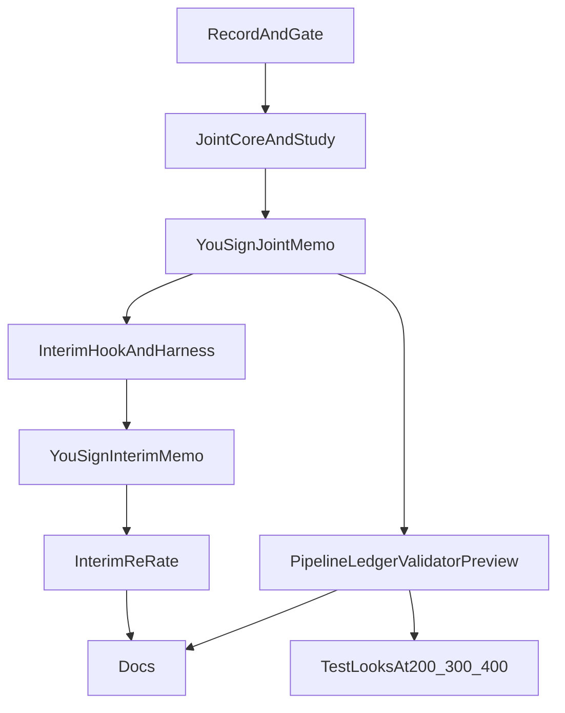

# VSR next-gen build

Builds everything settled in [the analysis plan](.cursor/plans/vtsr_next-gen_analysis_4d5207d7.plan.md): one fix to today's VSR-T, and a new commanding-and-fighting model (the "joint model") that runs beside today's ratings until a pre-registered test says whether it replaces them.

Visible text uses VSR-T and VSR-C, the names since the rebrand of 2026-11-24. Code, JSON keys and file names keep `vtsr`.

## Flow



Phase 2 comes before Phase 3 because the test clock starts on the day the joint memo is signed. Phases 3 and 4 are independent of each other.

## Phase 1: record and gate

- Run `python scripts/validate_elo.py` and `python scripts/vtsr_t_variants.py --since 2026-10-25`, then append what they print (the memos are append-only):
  - [critique/decisions/phase-6-faction-advantage-term.md](critique/decisions/phase-6-faction-advantage-term.md): the confirmation verdict (HOLD at 74 non-mirror duels on the last run).
  - [critique/decisions/vtsr-t-enemy-damage.md](critique/decisions/vtsr-t-enemy-damage.md): the forward check (57 decided games on the last run, no revert).
  - [critique/decisions/balonce-meter-t-term.md](critique/decisions/balonce-meter-t-term.md): the commander-fighting variant now passes its rule on 292 duels (65.8% against 62.3%), and the decision of 2026-11-20 to carry it in the joint model, not the ladder.
- New local gate `_investigation/check_balonce_parity.mjs`: every duel in `data/processed/elo_commander_history.json`, run through `VTBalonce.computeWinProb` in [js/balonce-meter.js](js/balonce-meter.js), must match the stored `expected` to 4 decimals. Register it in `_investigation/run_all_gates.py`.

## Phase 2: joint model core, study and memo

**[scripts/elo_joint.py](scripts/elo_joint.py)** (new; numpy; pure functions, no file writes)

- `compute_joint(all_match_data, elo_history, cmdr_history, external_duels)` returns `(current, history)`.
- `elo_history` and `cmdr_history` supply membership only: which matches and rows are rated, and the order of the 800 duels. No rating value is read.
- The model:

```
a game in quarter q:
  logit P(team 1 wins) = C[c1,q] - C[c2,q] + mean F[team 1,q] - mean F[team 2,q]    # fighters = rated thugs + commander
damage rows (recorded matches of 240 s or more; rows with enemy damage; teams with 2+ such thugs):
  v = ln(enemy_dealt + 100) - mean over the team's thugs
  thug       v ~ Normal(0.12 * (F - mean F of the team's thugs), noise[thugs on team, length band])
  commander  v ~ Normal(0.12 * (F - mean F of the team's thugs) + offset[player] + mu, noise_c[same])
priors:
  first quarter played   C ~ Normal(0, 0.75)          F ~ Normal(0, 2.0)
  each later quarter     C ~ Normal(C before, 0.055)  F ~ Normal(F before, 0.40)     # 0.11 and 0.8 a year
  offset ~ Normal(0, 0.22)
```

- A team's thug rows are scored together with the true per-thug noise (centred spread over `sqrt((k-1)/k)`).
- Noise table: within-player spreads on recorded duels before the freeze, by thugs on the team (2, 3, 4+) and match length (under 12, 12 to 20, 20 to 30, 30+ minutes). Today: 0.29 / 0.34 / 0.37 for thugs and 0.45 to 0.48 for commanders, times about 1.2 / 0.9 / 0.9 / 0.77.
- Fit: Newton steps with step-halving, warm-started from the previous fit, tolerance 1e-9. 1,099 parameters today.
- History: for each duel in order, `expected` from the fit on all earlier games, then each participant's skills before and after. Rows are memoised by a digest of their inputs, so a normal run refits only new matches (a full rebuild takes about 50 seconds).
- Reference numbers on data through 2026-11-18: 800 games, 2,466 damage rows. On the 252 recorded duels after the first 40: log-loss 0.5884 and 67.9% of winners, against 0.6280 and 62.7% for today's formula.

**[scripts/study_joint_skill.py](scripts/study_joint_skill.py)** (new; imports `elo_joint`; writes `_validation/joint_skill.{md,json}`)

- Back-test: the numbers above, beside the fixed-skill fit, decay, and old games counted less.
- Configuration check: the frozen settings against declared neighbours (loading 0.10 and 0.14, spreads 0.5 / 1.0 and 1.5 / 2.5, steps halved and doubled, half-year and two-month blocks), paired and out of sample. If a neighbour is ahead by more than two standard errors the script says so and the memo is not signed.
- Skill over time: the early-against-late shift tests and backward prediction of old F9 games.
- The noise table.
- Switch-test threshold for three looks, by resampling sessions (1.98 today).
- Largest gaps between results and damage per regular, with their uncertainty. This replaces the six-name check.

**[critique/decisions/joint-skill-model.md](critique/decisions/joint-skill-model.md)** (new; your sign-off freezes it)

- Model, settings, who counts, and what was already seen.
- Frozen baseline: today's win formula on today's VSR-T rules (lobby reference, no trim, lift on). Its `expected` for the 292 recorded duels is saved beside the memo as a fingerprint.
- Switch test, on recorded duels dated after the sign-off, read from the ledger (Phase 4):
  - Per duel: log-loss under the frozen baseline minus log-loss under the joint model.
  - Looks at 200, 300 and 400 duels. A look passes when the mean is at least 2.0 standard errors above zero, the joint model's calibration slope is not more than 2 standard errors below 1, and the joint model is also ahead of the live formula.
  - A pass switches the meter, VSR-T bands and VSR-C together, under its own plan. No pass by 400 ends the test.
  - The preview comes down if the joint model is behind by 2.0 standard errors at a look.
- Display rule for the switch, and an append-only amendments section.

## Phase 3: interim VSR-T revision

This supersedes the two-memo route in [the team-strength plan](.cursor/plans/team_strength_and_endgame_1728b6f3.plan.md).

**Inert hook** in [scripts/elo.py](scripts/elo.py), used by both `others` builders (`_shadow_score_match` near line 1320, `_rating_pass` near line 1760):

```python
EXPECTED_REFERENCE_POOL = "lobby"   # "lobby" | "opponents"

def _reference_indices(i, teams):
    everyone = [j for j in range(len(teams)) if j != i]
    if EXPECTED_REFERENCE_POOL != "opponents":
        return everyone
    opponents = [j for j in everyone if teams[j] is not None and teams[j] != teams[i]]
    return opponents or everyone
```

- Teams come from the row's slot, as the wins ladder already derives them. At the default, `elo_history.json` must stay byte-identical.

**Harness** [scripts/study_vtsr_t_fairness.py](scripts/study_vtsr_t_fairness.py) (new; stdlib; reuses helpers in [scripts/vtsr_t_variants.py](scripts/vtsr_t_variants.py); writes `_validation/vtsr_t_fairness.{md,json}`)

- Eight variants: reference (lobby, opponents) by trim (off, on) by lift (on, off).
- Per variant: team-gap slope, team-result share, split-half reliability, same-game tier ordering, winner AUC (all, and since 2026-10-25), likelihood gain over the commander gap, VSR-C replayed on it, and each regular's move and band.

**Memo** [critique/decisions/vtsr-t-interim-revision.md](critique/decisions/vtsr-t-interim-revision.md) (new; your sign-off before the run that counts)

- Candidate: opponents-only reference, late-demolition trim, lift off. Gates against today's rating on the full corpus:
  - Team-gap slope at most half of today's and within two standard errors of zero (seen: +0.040 to −0.001).
  - Team-result share down by a quarter or more (seen: 23% to 14%).
  - Reliability not lower (seen: 0.957 to 0.983).
  - Same-game tier ordering not lower by more than 1 point (seen: 70.7% to 73.4%).
  - Today's win formula on recorded duels not worse by more than 0.005 log-loss (seen: −0.0001).
- Winner AUC, each change alone and the lift-on bundle are reported, not gated.
- The memo states that these numbers were seen before it was written. Forward check: rerun after 40 more decided matches, and revert if the slope or reliability gate fails.

**Ship**, after sign-off and a passing run:

```python
EXPECTED_REFERENCE_POOL = "opponents"
ENEMY_DAMAGE_TRIM_LATE_STRUCTURE = True
LOWTIER_LIFT_ENABLED = False
ELO_SCHEMA_VERSION = 22            # re-rate; earlier peak_vtsr is not comparable
```

- `CMDR_ELO_SCHEMA_VERSION` 14 to 15 in [scripts/elo_commander.py](scripts/elo_commander.py), because the thug means it reads change. VSR-1v1 and VSR-2v2 are untouched.
- Run `python scripts/process_stats.py --no-prompt`, then the validator. Expect 7 of 24 regulars to change half-band; you review the list before it is committed.
- Copy: the expected-score caption in [js/vtsr-explainers.js](js/vtsr-explainers.js) ("against this exact lobby" becomes the other team); `renderFairnessTab()` in [js/elo.js](js/elo.js) (retire the "Stranded at base?" card, add one for end-of-game demolition).

## Phase 4: pipeline, test and preview

**Pipeline** ([scripts/process_stats.py](scripts/process_stats.py))

- New soft-fail block after the VSR-2v2 block (near line 12879): `elo_joint.compute_joint(...)` writes `data/processed/elo_joint_current.json` and `elo_joint_history.json`. Add both to the `load_cache_index()` skip set (near line 3291). If numpy is missing it warns and skips.
- [scripts/joint_test.py](scripts/joint_test.py) (new; stdlib): `frozen_baseline_expected()` replays today's rules in memory by setting the three switches back, `append_ledger()`, `score_ledger()`.
- `data/joint_test_ledger.json` (committed, append-only, beside `data/match_outcome_adjudications.json`): for each recorded duel after the freeze, the joint, frozen-baseline and live win chances as first computed. Later reprocessing cannot change a logged entry.
- `numpy>=1.26` in [scripts/requirements.txt](scripts/requirements.txt). No `PIPELINE_VERSION` or `match.schema_version` bump.

**Validator** ([scripts/validate_elo.py](scripts/validate_elo.py))

- New `metric_joint_model()` built on `joint_test.score_ledger()`: duel count, mean gain and standard error, the three looks, calibration slope, and a status (running, passed, ended, withdrawn).
- `report.json` schema 14 to 15. Additive `latest_detail.joint_model` in `validation_summary.json`.

**Preview** (display only; changes no rating, band or Suggest result)

- [js/balonce-meter.js](js/balonce-meter.js): `ensureJointLoaded()`, `jointWinProb()`, `jointPreviewHtml()`. One labelled line under the gauge, for example "New model (in testing): Team 1 62%", with a tooltip and a link to the explainer.
- Hidden when the files are missing, the sides are uneven, a commander is not set, or the preview has been withdrawn.
- Shown on the Outcome card (`zonePrematchHtml()`, from the stored pre-match value), the per-match Elo tab strip in [js/match-elo.js](js/match-elo.js), and Tools in [js/tools/team-balonce.js](js/tools/team-balonce.js) (computed from current skills).
- `renderAccuracyTab()` in [js/elo.js](js/elo.js): a card saying what the new model is and where the test stands.

**Local gates** (in `_investigation/`, registered in `run_all_gates.py`)

- `check_joint_separation.py`: `elo.py`, `elo_commander.py`, `elo_1v1.py`, `elo_2v2.py` and `js/all-matches-aggregator.js` never read the joint files.
- `golden_joint_inert.py`: `elo_history.json` and `elo_commander_history.json` are byte-identical with the joint block on and off.
- `check_joint_parity.mjs`: the JS win chance equals the stored `expected` for every recorded duel.
- `check_joint_config.py`: the module's settings hash equals the memo's.

## Phase 5: documentation

In the order the repo rules ask:

- [DEVELOPER_GUIDE.md](DEVELOPER_GUIDE.md): §13.7.10 for the VSR-T revision; a new §13.17 for the joint model, its ledger and its test.
- [docs/DATA_DICTIONARY.md](docs/DATA_DICTIONARY.md): the new files and the new `elo_current.json` fields.
- [.cursor/rules/project-overview.mdc](.cursor/rules/project-overview.mdc) and [.cursor/rules/data-schema.mdc](.cursor/rules/data-schema.mdc).
- [elo/analysis/index.html](elo/analysis/index.html): lift retired, roadmap Phase 7(c) closed, the joint model and its test.

## Your sign-offs

1. The joint-model memo. The day you sign is the freeze, and recorded duels after it count.
2. The interim memo, before the harness run that counts.
3. The re-rate's band changes, before they are committed.
4. The preview's wording.

## Not in this plan

- The switch itself. If the test passes, replacing the live ratings gets its own plan.
- Commander statistics for display, damage by target type, trade quality, pick-order recording.
- VSR-1v1 and VSR-2v2.
