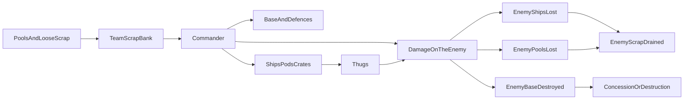
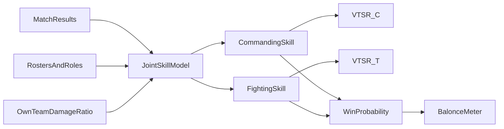

# VTSR next generation: evidence review and proposal

## Scope and method

- Analysis and brainstorming only. Every number below was computed read-only from [data/processed/](data/processed/), [data/external/f9_ledger.json](data/external/f9_ledger.json) and [data/odf.min.json](data/odf.min.json). Apart from this plan no file in the repository was written, so the scripts exist only in the session; making them permanent is the first todo.
- Corpus: 292 rated matches (2026-04-16 to 2026-11-18), 48 rated players, 34 commanders, plus F9bomber's 508 ledger duels with thug rosters. 800 games in all.
- Core instrument: one win/loss model over all 800 games in which each player has a commanding effect and a fighting effect. A side's strength is its commander's commanding effect plus the mean fighting effect of all its fighters, commander included.
- Second pass (2026-11-20): every testable claim in [peer_review_engineering_feedback_on_vtsr_next_gen_analysis_plan.md](peer_review_engineering_feedback_on_vtsr_next_gen_analysis_plan.md) was checked, and the joint model was prototyped with the damage observation added.
- Third pass (2026-11-22): the same for [the second review](.cursor/plans/peer_review_v2_feedback_on_revised_vtsr_next_gen_analysis_plan.md), [the net-versus-dealt study](.cursor/plans/net_vs_dealt_verdict_85a3f123.plan.md) and [the team-strength and end-game study](.cursor/plans/team_strength_and_endgame_1728b6f3.plan.md), including full re-rates the last one defers. The game-mechanics section is new.

## How the game works

This is my current understanding of a VSR team strategy match. Each statement carries its source:

- **(you)** your answers in this conversation
- **(ODF)** [data/odf.min.json](data/odf.min.json), the VSR unit and weapon files
- **(guide)** the vendored [ODF guide](docs/reference/odf-properties-guide.md)
- **(data)** measured on the 292 rated matches
- **(docs)** this repository's documentation
- **(web)** the VSR workshop page and Nathan Mates' Battlezone II notes

What I could not check is listed at the end of the section. Correct whatever is wrong.



### Match format

- **Teams.** Two teams of three to five. Team 1 holds slots 1 to 5 and team 2 slots 6 to 10; a thug's slot means nothing (you). The commander is the team leader in slot 1 or 6 (docs, web).
- **Sizes.** 5v5 in 47% of rated matches, 4v4 in 32%, 3v3 in 16%, uneven sides in the rest (data).
- **Forming teams.** Commanders volunteer. A coin flip gives first pick, picks alternate, and the flip's loser takes two of the last three. It happens over voice and is not recorded (you).
- **Who plays.** 25 to 30 active players and usually one game at a time, so the lobby is whoever turned up that night (you).
- **Factions.** Each commander chooses the team's faction (web). ISDF is picked in 50% of team-games, Hadean in 28% and Scion in 22%; both teams take the same one in 35% of matches (data).
- **Maps.** 77 different maps in the rated corpus, about 7 pools each, bases a median 960 m apart (data).
- **Length.** Median 15 minutes. A quarter of matches end within 11 minutes, a quarter last more than 22, and one in ten passes 48 (data).
- **Start.** Every player, commander included, starts in the faction's Scout (data).
- **House rules.** Anything the game allows is fair. The one convention is not to hit the enemy Recycler in the first minute or two (you).

### How a match ends

- **The game's rule.** A side loses when its Recycler and Factory are both destroyed (web). The pipeline's winner inference uses the same test (docs).
- **In practice** teams usually concede before the base is fully destroyed (you). The recording shows the loser's Recycler destroyed in 51% of rated matches and both buildings in 29% (data).
- **The recorded winner** is the host's end-of-game dialog in 70% of rated matches, your adjudication in 18% and kill evidence alone in 12% (data). Draws and cancelled games are not rated (docs).
- **The last three minutes are one-sided.** Winning thugs deal 8.5% of their match damage to buildings in that window, losing thugs 1.9% (data).

### Economy

- **One resource, one spender.** Scrap sits in a team bank and only the commander spends it (you, docs).
- **Storage** is 40 while the Recycler stands plus 20 for each extractor (docs, ODF).
- **Pools.** A scavenger (20 scrap, built at the Recycler) drives to a pool and deploys into an extractor in 5 seconds. The constructor can upgrade an extractor for 60 scrap, which doubles its rate (ODF). Teams hold 3 to 5 pools at their peak (data).
- **Income** is a median 84 scrap a minute per team, about a third of it loose scrap collected by scavengers (data).
- **The bank refills faster when it is low:** 2 a second near empty, 1 in the middle, a third of one near full (docs). Unspent scrap is lost income. The median team spends 17% of the match in the fast band and 30% in the slow one (data).
- **Loose scrap** comes from the map and from wrecks. A destroyed unit drops scrap (guide), for example 20 for an extractor and 10 for a scavenger (ODF).
- **Spending rules.** Scrap is charged when a unit starts building. Each producer builds one thing at a time. Cancelling at the factory returns about half (docs).
- **Losing a pool** cuts storage, destroys any scrap above the new cap (docs) and takes a median 93 seconds to replace (data).
- **Where the scrap goes:** scavengers 22%, combat ships 21%, buildings and gun towers 20%, empty scouts 10%, weapon crates 8%, extractor upgrades 5%, constructors 5%, service pods 4%, service trucks 3%, mobile turrets 2% (data).

### Production and tech

ISDF names. Hadean and Scion have the same roles under other names (ODF).

- **Recycler** (12,000 hull): scavenger 20, Scout 40, Empty Scout 20, mobile turret 40, constructor 40, service pod 2, service truck 50.
- **Constructor** places the buildings: Power 30, Factory 55, Relay Bunker 50, Armory 60, Service Bay 50, Gun Tower 50, Training Facility 70, Tech Center 80, Bomber Bay 100. Each needs earlier ones; a Gun Tower needs a Relay Bunker, for example. The commander has to be near the base at the moment of placing (you).
- **Factory:** Missile Scout 45, Mortar Bike 45, Tank 55 (needs a Relay Bunker), Rocket Tank 65, Assault Tank 70 (needs a Relay Bunker and a Service Bay), Walker 100 (needs a Tech Center).
- **Armory:** weapon crates at 10 to 40 scrap each. A player has to pick the crate up.
- **Faction differences.** Hadean upgrades its factory (80 scrap) to reach its heavy units. Scion upgrades its Kiln to a Forge (60) for the Warrior and Titan, and its craft switch between two modes (see Ships).
- **Typical order** (median minute of a team's first): scavenger 0.6, service pod 2.1, constructor 2.6, empty scout 3.5, extractor upgrade 3.6, power 4.2, factory 5.0, armory 6.0, service bay 7.8, relay bunker 11.3, tech center 12.4, tank 14.3 (data). The first Tank arrives about when the median match ends.
- **Volume per match, both teams together:** 83 service pods, 41 scavengers, 17 empty scouts, 3 tanks, 2 missile scouts built; 16 weapon crates picked up (data).

### The commander

- **Flies and fights like a thug** while doing everything in this section (you).
- **Only source of supply:** pods, crates, replacement ships, service trucks and base defences (you, ODF).
- **Assigns hulls,** giving heavier ones to stronger thugs first, and directs the team over voice or chat (you).
- **Commanding and fighting at once is a skill.** Many commanders fight less while commanding; the best do both (you). In the data the drop in a commander's own damage ranges from none to more than half.
- **Owns the AI:** scavengers, constructors, turrets, gun towers and service trucks. Units can be handed to a teammate, except Recycler vehicles and constructors (web). AI-owned damage is about 12% of a commander's damage in a typical match, a third over the whole corpus, and about 1% of a thug's (data).

### Thugs

- **Free agents.** Nothing forces a thug to do anything; team play and the commander's direction decide (you).
- **What they do:** hunt enemy players, kill scavengers and extractors, defend their own, and assault the base.
- **Who does what.** Stronger thugs mostly hunt players and pick the pool kills that matter. Weaker thugs do more of the pool work (you).
- **Their damage:** 40% lands on enemy players' ships and 60% on AI units and buildings (data).
- **Kills per match by target:** player ships 29, scavengers 16, extractors 10.5, AI combat vehicles 2, other buildings 1.6, Recycler or Factory 1.2, turrets 1.1 (data).

### Ships

Cost in scrap and hull points (ODF).

- **Armor class N, light:** Scout 40 and 1,800, Xypos 40 and 1,800, Scion Scout 40 and 1,200, Empty Scout 20 with the same hull, Missile Scout 45 and 2,000, Sentry 40 and 2,000, Warrior 55 and 3,500.
- **Armor class L, medium:** Tank 55 and 3,500, Xares 55 and 3,800, Lancer 55 and 2,300.
- **Armor class H, heavy:** Assault Tank 70 and 4,500, Hedoux 75 and 5,500, Titan 90 and 6,000, Walker 100 and 8,000.
- **What thugs fly:** scout-class hulls 37% of the time, Empty Scouts 23%, on foot 22%, tank class 12%, heavy 6%. In 72% of thug games the thug never spends 30 seconds in anything above scout class (data).
- **A heavier hull deals more.** A Tank puts out about twice a Scout's damage per minute, 3,081 against 1,533 (data).
- **Scion craft have two modes.** In the second they regenerate hull, 2 to 12 points a second, and most stop regenerating ammo. The ISDF Assault Tank and the Hadean Hedoux also regenerate hull; ISDF and Hadean scouts and tanks do not (ODF).

### Weapons and damage

- **Hardpoints.** Guns, cannons, mortars, rockets, specials and shields on ships; a hand weapon and a pack for pilots. A crate swaps the weapon on a matching hardpoint (docs, ODF).
- **Ammo.** Every shot draws on the ship's own ammo, which refills slowly by itself and quickly from a pod, truck or service bay (ODF).
- **Damage depends on the target's armor.** Per hit against light, medium and heavy: Minigun 11 / 8 / 5, AT-Stab cannon 130 / 120 / 100, Scion Plasma Cannon 100 / 80 / 16, Scion Ion Gun 20 / 10 / 1, the pilot's Pulse 5 / 3 / 0 (ODF).
- **Heavy armor covers the economy.** Scavengers, extractors, constructors, gun towers and every building are class H (ODF). A point of damage is cheapest against scouts and dearest against pools and bases, most of all for Scion craft.
- **Other weapon types:** lock-on missiles, mortars, mines and splash. Mine damage is credited to the player who laid it (docs).
- **Friendly fire is on** (you).
- **What VTSR-T counts:** damage to enemy players, scavengers, extractors, AI units and buildings, every point the same (docs).

### Repair and resupply

- **Service pod:** 2 scrap, 3.5 seconds to build, restores 1,500 hull and 1,500 ammo once (ODF, guide). It appears at the Recycler and is picked up there: 94% of thug pickups are within 150 m of their own base. A thug picks up 2.6 per ten minutes and is back at base about five times in ten minutes (data).
- **Service truck:** 50 scrap, needs a Service Bay, restores 40 to 50 a second to one craft or building next to it (ODF). Only its owner can order it (you). About one is built per match (data).
- **Service Bay:** 50 scrap, needs a Factory, restores 150 a second to craft and pilots within 32 m (ODF).
- **All three are the commander's to build** (you). Scion hull regeneration is the one repair a thug controls (ODF).

### Losing a ship and getting another

- **Ship destroyed:** the player is thrown clear and carries on on foot where it died. In the last 80 rated matches the thug was on foot six seconds later in 1,633 of 1,633 cases, a median 466 m from base (data).
- **On foot:** 100 hull, a Pulse gun that cannot hurt heavy armor, and a jetpack (ODF). New pilots and Empty Scouts are invulnerable for 15 seconds by default (web).
- **Killed on foot:** the player reappears at their own base, in 760 of 760 cases (data). Kills of players on foot do not count in the ratings (docs).
- **How often:** a thug's ship is destroyed 3.8 times a match and he is killed on foot 1.7 times. A quarter of vehicle-to-foot changes have no kill behind them: hopping out, bailing out, being sniped or changing ship (data, guide).
- **Three ways back into a ship,** all requiring the player to climb in (you):
  - The commander builds one. Either a ship passed to the thug, which may instead be left as AI support, or an Empty Scout at the Recycler for 20 scrap and 10 seconds.
  - Stealing an enemy ship.
  - Sniping an enemy pilot and taking the ship.
- **What happens in practice:** 60% of climbs back in are into an Empty Scout, 9% a Tank, 7% a Scout. Time in another faction's hull is 1.9% of vehicle time (data).
- **Sniping needs the commander too.** The default pilot gun has no sniper mode. The Pulse Rifle crate costs 30 scrap and needs a Relay Bunker or the faction's equivalent, and one shot empties the pilot's ammo, which takes 20 seconds to refill (ODF). Scouts, tanks and Scion morph craft can be sniped; assault tanks, walkers, turrets and tracked vehicles cannot (guide). There are 1.4 snipes a match, and 22% of matches have one (data).
- **Time on foot:** 22% of thug time (data). A thug on foot at base is usually waiting on the commander (you). Which thug it is explains 15% of that time and which commander 4% (data).

### What the recording holds

- **Recorded:** every shot and hit, damage with shooter and victim, units destroyed, snipes, pod and crate pickups, and each player's position, ship, hull, ammo and target lock every tick. Since schema v4 also both scrap banks every tick and every build order; since v5 pool plants. The host's end-of-game result since v3 (docs).
- **Not recorded:** voice and chat, orders to AI units, who was handed which ship, service-truck repairs, pick order, and intent.
- **Coverage:** 205 of 292 rated matches have economy and build data. Object handles exist for 23.

### What this means for a rating

- **A thug's damage partly belongs to the commander:** the hull, the pods, the crates, and how fast a new ship arrives. Comparing thugs within one team holds the commander constant.
- **Heavier hulls go to stronger thugs,** so adjusting damage for hull class would undo the commander's own judgment. Ship-adjusted damage tracks win impact at 0.67, raw damage at 0.90.
- **Damage is not equally cheap** across targets and factions, so faction leaks into a lobby-wide score. It cannot leak into a within-team score, because teammates share a faction.
- **Games end by concession after a one-sided finish.** That is the end-of-game leak in today's VTSR-T.
- **Most games are scout games.** The ratings mostly see scout-class fighting and pool raiding.
- **Target choice is the unmeasured skill.** Sixty percent of thug damage is on AI units and buildings, and which of it mattered is not recorded.
- **Stealing and sniping are too rare** to matter as a source of ships. In effect the commander is the only one.
- **Pick order is not recorded,** so any model takes the teams as given.

### Not verified

- The exact win rule in the VSR mission script. I relied on Nathan Mates' notes and the pipeline's inference.
- How a commander passes a ship in practice, and how often a passed ship is left as AI support. The recording does not show hand-overs.
- Whether the Recycler starts deployed. The first scavenger is ordered about 35 seconds in.
- Whether any lobby option in use changes the rules above (starting scrap, rejoin, invulnerability time).

## Corrections

To my earlier messages:

- "Damage share mostly captures a habit plus the team's fate": wrong. It tracks win-derived fighting effect at 0.78 to 0.92.
- "No cost side": not supported. Ships lost correlates −0.08 with win impact; net damage scores 0.77 against 0.90 for damage dealt.
- "Blind to opportunity, score against ships and minutes": not supported. Damage per in-ship minute scores 0.79 and ship-adjusted damage 0.67, both below raw damage on the same players.
- "No opponent adjustment in fights": makes no difference in this pool. Opponent-adjusted and raw kill share correlate 0.99.
- "A batch fit beats one-pass Elo": not for commanders alone (log-loss 0.6331 against 0.6338). The gain comes from adding fighting effects.
- "Your three-term variant lost 4.2 points": outdated. On 292 duels the commander-fighting variants gain 3.1 to 3.4 points and pass the registered rule.
- "The thug gap adds little (p about 0.07)": on 292 duels it is p = 0.0025.
- "The thug term is over-weighted": not shown. The fitted weight is 0.6 to 0.9 with an error near 0.25, and the mean beats minimum, median and maximum.
- "The draft explains weak thug-only prediction": only partly, see below.
- "70 to 78% is unsupported": rematches put the ceiling near 77%.
- "Model win probability inside the match": the prototype cannot call a winner before mid-game.
- "Test past economy as a predictor": done, nothing detectable on 145 duels.

To the first version of this plan:

- "Promote on the next 60 duels": underpowered. See the promote rule below.
- "No loss aversion or floor" as the fix for drift: the floor does nothing on this corpus and the commander allowance is the largest upward push.
- "Object handles are already on the wire": true for only 23 of 292 rated matches (since 2026-11-14). Damage by target class needs only the victim ODF, which 251 matches carry.
- The 68.3% headline was tuned on duels 100 to 450, which contain almost no recorded games (the first recorded duel is number 438). That is sound for the results-only model. Settings for the damage observation were chosen again inside the recorded era.

To the second version of this plan:

- "Noise is set per team size (0.21, 0.27, 0.32)": wrong as a likelihood. Those are spreads after centring on the team mean; the true per-thug noise is 0.29, 0.34 and 0.37. My prototype over-weighted damage rows by up to two times, and the half weight I had added was compensating for it.
- "Time decay restores movement": not measured then, and wrong. One-year decay raises a participant's movement from 3.7 to 4.3 points a game.
- "Freeze the settings grid": it has to be one configuration, chosen before the first confirmation duel.
- "Stage 1 switches the meter": replaced by a preview, at your decision.
- "Start recording drafts now": dropped, at your decision.
- "Fixes arrive with the joint model, not as separate patches": still true for drift, the lift and commander fighting. The two narrower leaks in today's VTSR-T now get one interim revision.

## Findings

### How games form

- Your account: commanders volunteer; the coin-flip winner picks first; picks alternate; the loser takes two of the last three (5v5: A B A B A, then B B, then A). The commander assigns hulls, gives heavier ones to stronger thugs, and is the only source of a replacement ship.
- Thug gaps between drafted teams are about 28% smaller than random splits of the same players. The two top-rated thugs land on opposite teams 75% of the time against 60% by chance.
- The team holding the top-rated thug won 52.8% (121 of 229), so first pick shows no measurable edge. By my calculation your pick order leaves the first picker about 30 points of thug mean, roughly 3 points of win chance, if both commanders rank players alike.
- The stronger commander tends to have the weaker thugs (r = −0.32). That hides the thug effect in any thug-only test: the thug gap alone is not significant, but with the commander gap in the model it is (p = 0.0025).
- The commander gap (SD 137 points) is larger than the thug-mean gap (SD 113) and is never drafted. It is the main source of lopsided nights.

### What decides a match

- Fighting effects are real: log Bayes factor 13.3 (commanding 31.6). In 25 simulations with commander effects only, on the real rosters, the same test never rose above −4.9.
- They are stable: split-half 0.73 (0.84 corrected), against 0.39 (0.56) for raw thug win rate on the same halves. The repo's 0.30 for win rate is right; the estimator was the limit, not the signal.
- Sizes, uncertain by roughly half: commander macro skill SD about 130 points, one fighter about 70 in a 5v5, four thugs together about 140.
- The commander's own fighting counts at least as much as a thug's (best fit 1.5 to 2 times; log Bayes factor 7.4 over zero). Two independent checks agree: p = 0.006 in a regression on published ratings, and validator §14 `cmdr_in_mean` at 65.8% against 62.3% on 292 duels (log-loss 0.611 against 0.631), flagged eligible under [critique/decisions/balonce-meter-t-term.md](critique/decisions/balonce-meter-t-term.md).
- Commanding and fighting skill correlate about 0.6 across the 18 players who do both.
- Results-only joint model, out of sample (walk-forward, last 350 duels): 68.3% of winners against 63.4% for today's ladders (p = 0.057). Log-loss is 0.608 against 0.616, and that interval spans zero.
- With the damage observation added (settings chosen on 106 recorded duels, scored on the last 146): log-loss 0.612, against 0.630 for the results-only model and 0.638 for today's ladders. Winner calls are 65.1%, 67.8% and 59.6%. Every interval spans zero at this size. The best damage loading is 0.12 to 0.16 in both windows, which is where the data's own spread says it should be. The corrected likelihood leaves these figures unchanged.

### What the damage axis measures

Career averages over thug games, 23 players unless stated.

- Damage share against fighting effect: 0.78 to 0.92 depending on who is included (16 to 28 players). Against the effect from F9 games only, which share no games with the damage data: 0.74 to 0.89.
- Lagged test: thugs' averages from earlier matches predict the next result with the commander gap controlled (z = 3.5 on 228 matches). Ships lost does not (z = 0.6).
- There is one axis. The first principal component of 11 career statistics holds 65% of their variance and correlates 0.94 with fighting effect. It loads evenly on damage dealt, PvP damage, PvP kills, damage taken, activity and little time on foot. The second component, PvE damage and kills, correlates 0.02.
- v2.14 was an improvement by this test: the four-axis composite scores 0.84, the single axis 0.90. No composite I tried beats the single axis beyond noise (0.87 to 0.93).
- A PvE weight between 0.25 and 1.0 is indistinguishable; 1.5 and 2.0 are worse (0.85, 0.84).
- By target: player-ship kills +0.88, extractor kills −0.55, scavenger kills −0.54. Your account explains it: weaker thugs do more pool work, and strong thugs choose when a pool kill matters. That choice is not measured anywhere.
- A thug's per-match score moves with the team result (23% of its variance). Scored within the own team as a share or a log-ratio, damage works at every team size: no dependence on the team result, repeatability 0.27 to 0.30 against 0.26 today, and the same link to win impact (0.90).
- Removing end-of-game base demolition from today's lobby score raises repeatability from 0.26 to 0.31 and cuts the team-result share from 23% to 13%, with the link to win impact unchanged (0.89).
- Time on foot at base: which thug it is explains 15% of the variance, which commander 4%. That fits your account if commanders re-ship their best thugs first.
- Largest gaps between win impact and damage, all within about two standard errors: higher on impact blue, M.S and Cyber; lower Nomad, dd and sponge. Whether those ring true to experienced players is the cheapest check on the whole model.

### Commander games

- Fighting while commanding correlates 0.91 with fighting as a thug (15 players). The drop averages −0.20 (shipped allowance 0.171) but ranges from −0.52 to +0.06 (SD 0.17).
- You called that drop a commanding skill. The data agrees: commanders who fight more while commanding have better commanding effects (0.64 with the win/loss level removed, 0.69 against the F9-only effect), and it is the only commander statistic whose history predicts the next duel (z = 2.1 on 216).
- Commander rows are about twice as noisy as thug rows on the own-team log-ratio (variance ratio 2.1), and the per-player offset varies by 0.22 around a mean of −0.22 after sampling noise is removed.

### VTSR-C and commander statistics

Exploratory: 14 to 16 commanders.

- With the win/loss level removed, three of the four axes in the inert economy composite barely relate to commanding effect: whole-game pool lead 0.00, upgrade time −0.11, non-green share 0.20.
- Better candidates: own fighting 0.64, unit scrap spent per minute 0.57, combat ship value per minute 0.43, pool lead in the first 8 minutes 0.40, AI-army damage 0.37 (0.91 against the F9-only effect on 11 commanders).
- No economy axis's history predicts the next duel on 145 duels (all |z| below 1.6). By my estimate a modest effect needs 400 to 900 eligible duels to detect, which is 5 to 11 months at the current 80 recorded duels a month.

### Ceilings and speed

- Same two commanders, thugs re-drawn, same night: the same commander wins again 54% (38 of 70). That caps any commander-only rating near 65%, and VTSR-C is at 63%.
- Identical teams replayed the same night: 65% (28 of 43), a ceiling near 77% with a wide interval.
- One match of damage share carries about 28 times the information about a thug that one result does. After 10 games damage share ranks thugs at 0.65 against long-run win impact; win rate is at −0.14.
- Ship losses are cheap: about a quarter of team income (345 of 1,240 scrap a match), one ship per thug every 5.7 minutes.
- In-match state (pools, net combat value, front line) calls the winner 50% of the time through the first quarter, 65% at mid-game and 90% in the last fifth. It is not a basis for per-action credit.

## First peer review: what held and what did not

### Confirmed by the data

- **Coupling commander fighting into the ladder changes what VTSR-C means.** Replayed: veterans move 13 points on average and up to 66, and the move tracks their own VTSR-T at −0.77 (VTrider −61, DraconisMarch +66). VTSR-C would become macro skill above fighting.
- **The gain is partly a cold-start effect.** Three quarters of the log-loss gain sits in the 38% of duels where a commander has under 20 prior duels. The gain in winner calls is even across experience (+3.3 to +4.6 points). Among established pairs the log-loss gain (−0.008) cannot be told from zero.
- **The term works without touching the ladder.** Applied to the prediction only: 66.8% against 62.3% (p = 0.047).
- **The commander offset belongs on the damage observation only**, with commanding skill absorbing what the drop costs in wins. The noise and offset figures above support it.
- **Display total commanding strength.** Macro plus own fighting share correlates 0.97 with today's VTSR-C; macro alone 0.91 (VTrider would rank 7th on macro, 3rd on total).
- **Identifiability.** For a commander-heavy player (mort: 54 commands, 2 thug games) commanding and fighting trade off at −0.62 and fighting is uncertain by about 100 points. For regulars it is −0.2 and about 35 points. The total is better determined than either part.
- **A batch refit moves players who did not play:** 0.3 points a game on average, 7.6 at most.
- **Own-team scoring:** per-team z-scores collapse with two thugs, an own-team score needs an own-team expectation (today's reference in [scripts/elo.py](scripts/elo.py) is the median of everyone else in the lobby, both teams), and it is zero-sum among teammates, so it belongs inside a results-anchored model.
- **The low-tier lift.** With it off, all three validity checks improve slightly (rating-to-performance correlation 0.449 against 0.433, thug-gap calls 56.5% against 55.6%, likelihood gain over commanders 5.56 against 5.35). It raises 8 players, by up to 112 points.
- **Phase 6 has passed 60 confirmation duels.** It stands at 74 and the validator's verdict is HOLD under the memo's own rule (refit +7 points, frozen term worsens log-loss). The memo has not been appended.
- **No Python-to-JS parity gate exists** for the win probability.
- **Commander statistics on 11 to 16 commanders are too fragile** to register a scoring rule.

### Not supported, or wrong

- **Time decay as a required fix.** Every setting tested is equal or worse out of sample: log-loss 0.5922 static, 0.5937, 0.5979 and 0.6026 at 365, 180 and 120 days.
- **A correlated prior frozen at 0.6.** Full-data evidence mildly prefers it (+3.0), but out-of-sample log-loss is worse on the later window (0.6115 to 0.6227) and overall (0.5901 to 0.5940).
- **"The log-ratio is naturally scale-free."** Its spread is 0.24, 0.32 and 0.38 with 2, 3 and 4 thugs. Most of that growth is the centring itself (see the second review); the underlying noise still rises, from 0.29 to 0.37.
- **"Loss aversion and the 1000 floor caused the drift."** Ratings are identical with the floor off. Removing the commander allowance lowers the pool mean by 115 points, removing loss aversion by 64. With every adjustment off the pool deflates to 1375, so the 1622 is the net of opposing effects.
- **"Scrap weighting will up-weight economic targets."** It is the reverse: extractors are worth 4.0 scrap per 1,000 hull points and scavengers 6.7, against 11 to 33 for scouts and 15.7 for a tank. The research stays low priority because the PvE weight sweep is flat, not for the reason given.
- **"Strip late demolition first" as an untested step.** It was scored on 2026-10-24 and again here (figures under Findings).
- **A promote rule on 60 duels.** It would pass 16 to 25% of the time if the joint model is truly better by what was measured. An even chance needs 170 to 410 duels.
- **Retiring the commander economy composite "rather than waiting years".** The evidence is 14 to 16 commanders, which the review itself calls fragile at 11, and the wait is months. The composite is inert and costs nothing to leave.
- **"Likely +1.5 to +3.5 points" true gain.** No derivation is given. The honest statement is a wide interval.
- **`scipy.optimize` and "exact reproducibility across machines".** The rating code is stdlib-only ([scripts/requirements.txt](scripts/requirements.txt) lists protobuf, psutil, Pillow). A Newton solver needs numpy or a slower pure-Python loop, and the problem is convex only once the fighter weight and damage loading are frozen.
- **Handle decoding "covers v2+".** Handles exist on 23 matches. Target class by victim ODF covers 251.

### Where the review and your earlier choice differ

- The review recommends one fighting number; you had chosen two, and have now settled on one (see Decisions). Tested: the joint fighting skill and a damage-only estimate rank players at 0.99 and never differ by more than 53 points, so results barely move the band at this population and a second number adds little.
- The larger change is the method. Against today's published VTSR-T the joint fighting skill ranks 24 ladder players at 0.94, and 6 of them move more than 100 points (Domakus −151, Nomad −134, Cyber +132, Certified Bad Guy +121). None moves a full tier.

## Three more documents: what held and what did not

### Second peer review

Confirmed:

- **The noise bug is real.** Centring k thug rows on their team mean leaves each with (k−1)/k of the true variance, and the exact likelihood divides by the true variance. Using the centred figures as if the rows were independent over-weighted damage rows by 2.0, 1.5 and 1.33 times for 2, 3 and 4 thugs.
- **Fixing it changes little and removes a setting.** Scoring-window log-loss is 0.6119 either way. With the exact likelihood full weight does as well as the half weight I had added (0.6119 against 0.6120), so the half weight goes.
- **The commander row separates cleanly,** as the review derives. Its measured spread is 0.48, 0.45 and 0.45 at the three team sizes, of which 0.41 to 0.44 is the commander's own.
- **Stage 1 would split the screen,** by more than the review estimated. The joint model's win chance differs from today's meter by 10 points or more in 56% of 252 recorded duels and names a different favourite in 20%. The two "main reason" lines agree in 51%.
- **One frozen configuration, not a grid.** Agreed.
- **A reference team size for the displayed commander number.** Four fighters instead of five moves commanders 13 points on average and 35 at most, with the same ranking (0.997). Five is the commonest size.
- **Zero-damage rows.** Three rated commander rows have no enemy damage and 10 sit below −2.0 on the log-ratio. Switching to heavy-tailed, length-scaled noise moves DraconisMarch, who has one of the zero-damage rows, by 45 points; nobody else moves as much.
- **Per-match changes must be read from the match's own row.** A refit moves players who did not play by 0.33 points a game on average and 10.8 at most.
- **numpy is already used by operator tools** (`scripts/map_match_video.py`, `scripts/verify_terrain_scale.py`, the model converter). It is not in [scripts/requirements.txt](scripts/requirements.txt), and the rating scripts do not import it.

Not supported:

- **One-year decay to keep bands alive.** A participant's fighting skill moves 3.7 points a game static, 4.3 at one year and 4.9 at half a year, against 13.6 today. Decay does not buy the movement and costs accuracy over the recorded era (log-loss 0.5908, 0.5936, 0.5985).
- **The static fit is not frozen.** Over its last 146 duels regulars moved 42 points on average and one moved 191.
- **VTSR-C does not have the problem.** Commanding skill moves 7.2 points a duel in the static fit, against 8.9 today.
- **"Machine precision across machines."** Warm and cold starts agree to 1e-15 on this machine. Across machines numpy's linear algebra can differ in the last bits, so a gate should compare with a tolerance, not a file hash. There is no CI in this repository, so it matters only if someone else re-runs the pipeline.
- **A headcount term for uneven lobbies.** 15 rated matches had uneven sides and the larger side won 7. That is too few to fit a term.
- **Draft capture by lobby polling.** Dropped: picks happen over voice (Decisions).

My additions from the same runs:

- **Noise falls with match length.** The damage loading is the same at every length (0.11 to 0.13), but the leftover spread drops from 0.35 in matches under 12 minutes to 0.20 at 30 to 60 minutes.
- **Heavy tails.** Noise that is heavy-tailed and scaled by match length gives the best scoring-window log-loss (0.6096 against 0.6137 for plain Gaussian noise estimated the same way). The difference is inside the noise: 0.003 ± 0.004 over 252 duels.
- **Against today's prediction** the joint model is ahead by 0.038 log-loss over the 252 recorded duels (standard error 0.020). Those duels also chose the settings, so read it as an upper bound.

### Net versus dealt

Every headline figure reproduces. Where mine differs it is in brackets.

- **Skill tests.** Per-game scores correlate 0.92 [0.93]. Reliability is 0.955 for dealt and 0.929 for net. The team result explains 23% and 27%.
- **Damage taken.** Reliability 0.956, correlation with dealt 0.13, team-result share 4%. The higher tier took more damage in 66% of same-game pairs and less per point dealt in 56% [55%].
- **Team level.** Dealt more won 91.3%, ahead on net 91.0%, took less 69%, took less per point dealt 86%.
- **Forward check since 2026-10-25.** 57 games, AUC 0.610 dealt, 0.597 net, 0.613 four-axis. No revert.
- **Tiers under net.** 12 of 24 regulars keep their band and none moves two tiers [15 keep their tier, the document says 16; final ratings correlate 0.92, the document says 0.90].
- **Faction and length.** Scion wins 35% under 30 minutes and 79% beyond, 14–0 against ISDF beyond. The team that dealt more won 95%, 77% and 64% at the three lengths.

One label is missing:

- **The faction figures** (ISDF +0.145, Hadean +0.022, Scion −0.016) are for non-mirror matches. Over all rated matches they are +0.100, +0.025 and +0.003.

What it adds here:

- **The same verdict from another direction.** Against win-derived fighting effect net scored 0.77 and dealt 0.90.
- **Damage taken is exposure.** In my career-level test players who take more damage have more win impact (0.83).
- **Trade quality:** I would not register it. Damage taken per point dealt is less reliable (0.81), orders same-game tiers 55% of the time, and its link to win impact turns negative once damage dealt is held fixed (+0.21 raw, −0.38 partial, not significant).
- **Faction cannot leak into the joint model's damage observation,** because teammates share a faction.
- **Long games.** Team damage totals say less about the winner in long games, but within a team damage says more about the thug: the correlation between the own-team observation and fighting skill rises from 0.51 under 12 minutes to 0.73 at 30 to 60.

### Team strength and end-game

Confirmed exactly:

- **Team-strength leak.** Slope +0.040 per 100 points of team gap (z 4.0), +0.033 with own rating held fixed. The bottom fifth of team gaps averages −1.2 points a game against +3.4 to +4.8. Own rating and team gap correlate −0.32.
- **End-game leak.** Winners +2.40 and losers −2.54 points a game. 672 of 1,921 thug rows move more than 5 points and 10.7% change direction. The deciding tick is missing in 209 of 292 matches, and recordings end a median 10 seconds after it.

New, from full re-rates in memory (the document defers these):

- **Opponents-only reference.** The slope falls to +0.007 (z 0.8) and reliability from 0.957 to 0.953. With the lift off, regulars move between −52 and +56 points, not the −73 to +150 of the straight-line estimate, and stronger players rise (correlation with rating 0.47).
- **It interacts with the low-tier lift.** With the lift on, judgeguns rises 64 points instead of falling 52. The lower rating makes him eligible for the lift (factor 0 to 0.59), which more than gives it back.
- **Late-demolition trim.** Team-result share 23% to 14%, reliability 0.957 to 0.979, slope still +0.032. Largest moves: Snake +87, Domakus +64, VTrider +52; Monkey −64, Darkvale −60, dd −48.
- **Both together.** Slope −0.001, team-result share 13%, reliability 0.972. Six of 24 regulars change half-band.
- **The cost is prediction.** The thug gap's likelihood gain over the commander gap falls from 4.87 to 3.37, and winner AUC since 2026-10-25 from 0.610 to 0.602. Removing a win signal from a personal score makes it a weaker predictor.
- **The two leaks are one thing seen twice.** With the match result held fixed the team-gap slope disappears (−0.014, z −1.5). Stronger teammates mean more wins, and winners out-damage losers.
- **The joint model has neither leak by construction.** Its damage observation sums to zero within a team, so no team-level quantity can enter: not the team gap, the result or the faction. Trimming late demolition inside it makes no measurable difference (scoring-window log-loss 0.6131 against 0.6119).

## My take

- VTSR-T is legitimate, more than I credited. On every test damage share is the best or joint-best single statistic, and the data says there is essentially one axis: engagement. Your axis retirements moved in the right direction.
- VTSR-C is legitimate and already at the ceiling for a commander-only rating. Its next gain is fighters, not economy axes.
- The weakness is architectural. Three ladders hold evidence about the same players and do not share it: VTSR-T ignores results, VTSR-C ignores the commander's own fighting, and the wins ladder is a weak estimator of a real signal.
- The two VTSR-T studies found that weakness from the other side. A lobby-wide personal score absorbs the team result, through the teammates and through the last three minutes. Patching it is right, and it costs prediction, because today one number does two jobs.
- What I think you were sensing: target judgment ("knowing where to deal damage"), which nothing measures; commander games distorting individual ratings; the team result leaking into a personal score; and a meter that treats the commander as if they did not fight.
- "Can the real axes be found programmatically?" Yes. Three instruments now agree: the joint model as the criterion, the career-level comparison against it, and the lagged test. Today they return one axis for thugs, and too few commanders to decide for VTSR-C.
- Both reviews' modelling fixes are mostly right. Their numbers, the first promote rule and the case for time decay needed correcting. Confirmation of the joint model will take months, which is why the two VTSR-T leaks get an interim revision.

## Proposal: one model, two skills, three outputs



```
logit P(A wins) = (C_cmdrA - C_cmdrB)
                + mean F over A's fighters - mean F over B's fighters   # commanders included, at their thug-level F
                + matchup terms                                         # faction, map; start at 0

thug:       v_i = ln(d_i + 100) - own thugs' mean   ~ beta * (F_i - mean F of own thugs)            + noise
commander:  v_c = ln(d_c + 100) - own thugs' mean   ~ beta * (F_c - mean F of own thugs) + offset_c + noise
offset_c ~ Normal(group mean, group spread)         # one per player, shrunk toward the group

thug noise:      a team's k rows are scored together: sum of squared residuals / sigma_k^2,
                 sigma_k = centred spread / sqrt((k - 1) / k)   # 0.29, 0.34, 0.37 for k = 2, 3, 4
commander noise: 0.45 to 0.48, independent of the thug rows
both:            scaled by match length and heavy-tailed (Student t, 5 degrees of freedom)

exported per player: commanding skill, fighting skill, their uncertainties
displayed VTSR-C = commanding skill + one fifth of fighting skill      # total commanding strength, five fighters
displayed VTSR-T = fighting skill
```

- **Two skills per player**, commanding and fighting, each with an uncertainty read from the curvature at the fitted values.
- **Results are the anchor.** They are the one kind of evidence a player cannot farm. [TrueSkill 2](https://www.microsoft.com/en-us/research/publication/trueskill-2-improved-bayesian-skill-rating-system/) states the rule: "the more control that a player has over a quantity, the less useful it is for skill rating". Overwatch [removed performance adjustments above Diamond](https://kotaku.com/soon-all-that-will-matter-in-high-rank-overwatch-match-1821139905) for that reason.
- **Damage, scored within the own team as a log-ratio, is the fast evidence about fighting.** It places a thug in about 10 games where raw results need hundreds. TrueSkill 2 has this structure, and so does basketball's [box-score prior on adjusted plus-minus](https://jeremiasengelmann.substack.com/p/nba-adjusted-plus-minus-how-to-build).
- **Noise.** Larger in short matches, and heavy-tailed so that one idle game cannot move a player far.
- **Commander games:** one offset per player on the damage observation only. A commander who fights less while commanding keeps their thug-level fighting skill, and the cost shows up in commanding skill. That matches your view that doing both jobs at once is a commanding skill.
- **Who counts.**
  - Camera-pod, low-activity and zero-damage thug rows are not fighters and give no damage row, as today.
  - A commander with no enemy damage gives a result but no damage row.
  - A benched player (one match so far) gives no damage row.
  - Uneven sides use the mean of the fighters present, with no headcount term.
- **Fitting:** maximise the penalised likelihood with Newton steps in numpy. It is deterministic on one machine, and a full walk-forward history takes seconds.
- **One frozen configuration.** Today's leader is damage loading 0.12, prior spreads 0.75 and 2.0, no correlation and no decay. A committed script re-derives it on data up to the freeze date. Nothing is chosen on confirmation duels.
- **History:** a player's `before` is the fit on all earlier matches and `after` the fit including this one. Only participants get a row, and every per-match change shown anywhere is that row's own after minus before. The small moves of players who did not play are documented, not displayed.
- **No drift by construction:** skills are centred by their prior. No loss aversion, floor, commander allowance or lift is needed, and no sum-to-zero constraint either.
- **Responsiveness.** A participant's fighting skill moves 3.7 points a game against 13.6 today; commanding skill moves 7.2 a duel against 8.9. Much of today's movement is noise. Per-game verdicts ("beat expectation") can still come from the game's own damage row.
- **At 1,000,000 players:** the same model with online updates per match and skills that drift over time. Performance evidence does the placement, results take over as games accumulate, and the win probability becomes the matchmaker's objective.
- **What it enables now:** before the pick, the meter could say which two volunteers make the fairest commander pairing.

## Interim VTSR-T revision

Decided 2026-11-22: one revision of today's VTSR-T, ahead of the joint model.

- **What changes.** The expected-score reference becomes the median of the opposing team, and building damage in the last 180 seconds leaves the damage share.
- **How.** One memo written before the harness runs, then one re-rate if it passes. This replaces the two memos in [the team-strength plan](.cursor/plans/team_strength_and_endgame_1728b6f3.plan.md); that plan's inert hook and harness steps stand, and its all-damage trim stays optional.
- **The memo has to settle three things first.**
  - **The yardstick.** The trim failed the winner-AUC guard on 2026-10-24, because stomp damage predicts winners. For a personal score the gates should be reliability, team-result share, the team-gap slope and same-game tier ordering. Winner prediction is a cost to report, not a gate.
  - **The lift.** Score every variant with the lift on and off and list each regular's move both ways. Where the reference fix moves a low-tier player through the lift, as it does judgeguns, the memo says so before sign-off.
  - **The joint model's baseline.** Its switch rule compares against today's win formula. The joint-model memo names that formula by commit, so this re-rate cannot move the yardstick mid-test.
- **Knock-ons.** VTSR-C reads thug means and VTSR-2v2T the same damage field, so the harness reports both.
- **When.** After the joint-model memo is frozen, so the confirmation clock is not delayed.

## Suggested order of work

1. **Housekeeping.** Save the studies as scripts beside [scripts/validate_elo.py](scripts/validate_elo.py). Append the 74-duel HOLD to [critique/decisions/phase-6-faction-advantage-term.md](critique/decisions/phase-6-faction-advantage-term.md) and the 57-game forward check to [critique/decisions/vtsr-t-enemy-damage.md](critique/decisions/vtsr-t-enemy-damage.md); the net-versus-dealt plan lists the same two appends, so do them once. Add a parity gate so [js/balonce-meter.js](js/balonce-meter.js) and [scripts/elo_commander.py](scripts/elo_commander.py) are checked against each other on fixture lobbies.
2. **Write and freeze the joint-model memo.** The structure above, one configuration, the baseline named by commit, the preview and switch rules. Confirmation duels count from the freeze, even before the model is built.
3. **Interim VTSR-T revision.** Hook, harness, one memo, one re-rate.
4. **Build the joint model as a forensic alt mode** in its own module, emitting its own current and history files beside the canonical ones, and show its win chance as a labelled preview.
5. **Close Phase 7(c) now.** Commander fighting in the meter, drift removal and the lift's retirement arrive with the joint model.
6. **Backlog.** Commander statistics as display-only telemetry; target-class decoding.

## Decisions

### Decided on 2026-11-22

- **Stage 1 is a preview.** The joint model's win chance is shown as a labelled second reading wherever the meter appears. It changes no rating, band or suggestion. The meter, the VTSR-T bands and VTSR-C switch together.
- **One interim VTSR-T revision** for the two leaks, as described above.
- **Pick order is not recorded.** Picks happen over voice, nobody should have to write them down, and the resulting teams are what the model uses. The draft sidecar and the first-pick term are dropped.

### Decided on 2026-11-20, as amended

- **One fighting number.** The joint model's fighting skill becomes the VTSR-T band once it is promoted. There is no separate predictive value.
- **Commander fighting in the win prediction waits for the joint model.** No standalone change to [scripts/elo_commander.py](scripts/elo_commander.py) or [js/balonce-meter.js](js/balonce-meter.js), even though the term passes its registered rule. The memo should record why: coupling it would turn VTSR-C into macro skill only.
- **Switch rule.** One configuration is frozen before the first confirmation duel.
  - Everything switches when log-loss is better than today's formula by at least 0.010 and calibration is no worse, scored every 60 recorded duels up to 400.
  - With that many looks the per-look threshold has to be about 2.2 standard errors to keep the false-pass rate at 5%; at the usual 1.645 it is 15%.
  - At that threshold it passes 39 to 70% of the time if the joint model is truly better by what was measured, typically after 180 to 240 duels (about 3 months). It may not pass within 400.
- **Low-tier lift retires with the joint model,** unless the interim memo's on/off numbers argue for sooner at sign-off. The all-tier extension (roadmap Phase 7(c)) is closed now.

### Proposed defaults, unless you object

- **VTSR-C displays total commanding strength** at a five-fighter team. The files also carry the two parts, so the meter computes the exact chance for the actual team sizes.
- **The commander economy composite stays inert** under its own rule.
- **No time decay.** It adds 0.6 of a point of movement a game and costs accuracy.
- **numpy for the joint model only,** in its own module with a soft-fail block like the 1v1 and 2v2 ladders, and added to [scripts/requirements.txt](scripts/requirements.txt). Today's ratings stay stdlib-only. Gates on the joint outputs compare with a tolerance.
- **The preview comes down** if the joint model is behind today's formula by more than 2.2 standard errors at any look.
- **No trade-quality memo.**

### Still open

- **Sanity check on six names.** Do blue, M.S and Cyber win more than their damage suggests, and Nomad, dd and sponge less? Best asked blind of two or three veterans once the forensic output exists.
- **Whether the lift goes in the interim revision.** Decided at the memo's sign-off, on its on/off numbers.
- **The four items under "Not verified"** in the mechanics section.

## Limits

- The career-level tests rest on 16 to 28 players. One player moves a correlation by 0.1.
- No out-of-sample log-loss difference in this plan has an interval that excludes zero, except commander fighting on the full 292 duels. Winner-call differences reach p = 0.01 to 0.06.
- I ran many comparisons, and the scoring window has now been looked at many times. Only confirmation duels after the freeze are clean.
- The comparisons are correlational. Stronger thugs get heavier ships, so damage partly reflects the commander's judgment of the thug.
- F9 games carry rosters and results only, and their name mapping is the importer's.
- The joint model here is a prototype built in memory. It has no matchup terms and no time dynamics.
- The interim re-rates were also run in memory, by patching a copy of [scripts/elo.py](scripts/elo.py). The harness has to reproduce them.
- The mechanics section mixes sources of different strength. The web items and the "Not verified" list have not been checked against the game itself; I did not need the game executable and did not decode raw sessions.
